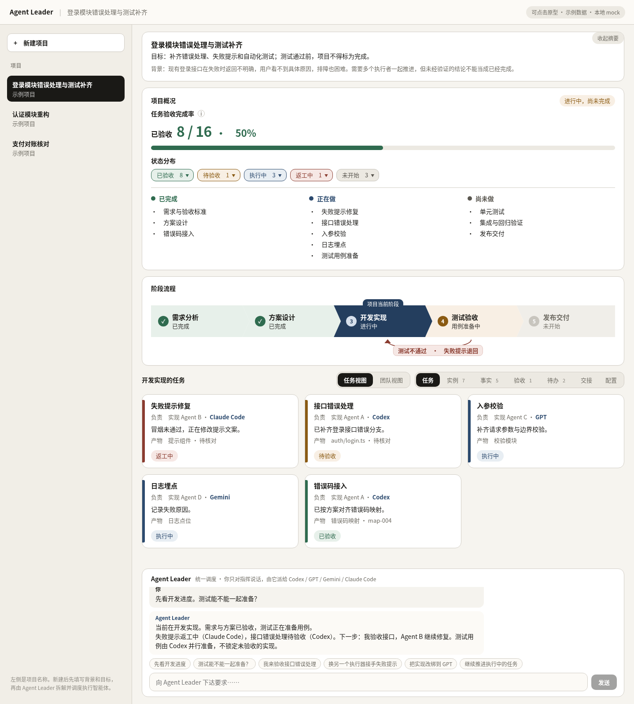
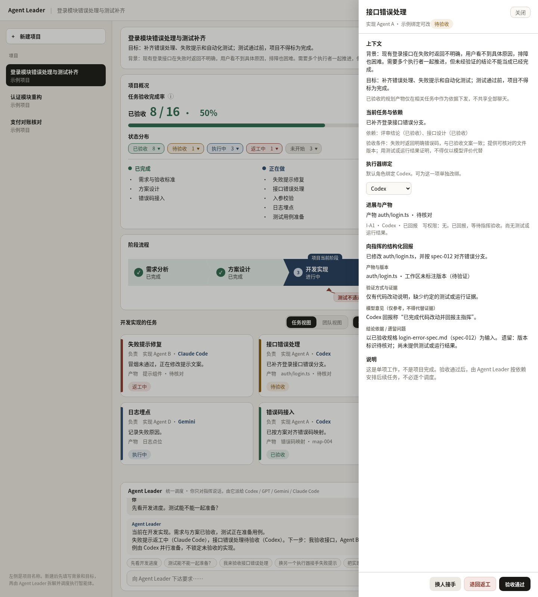
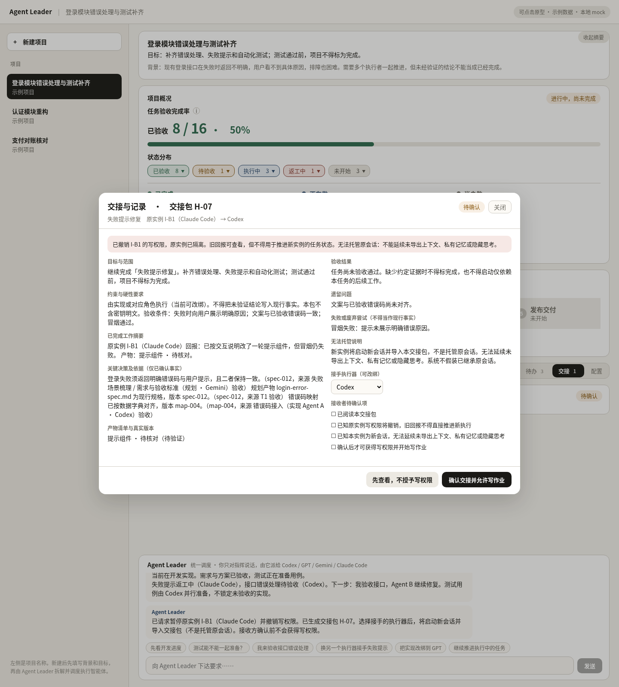
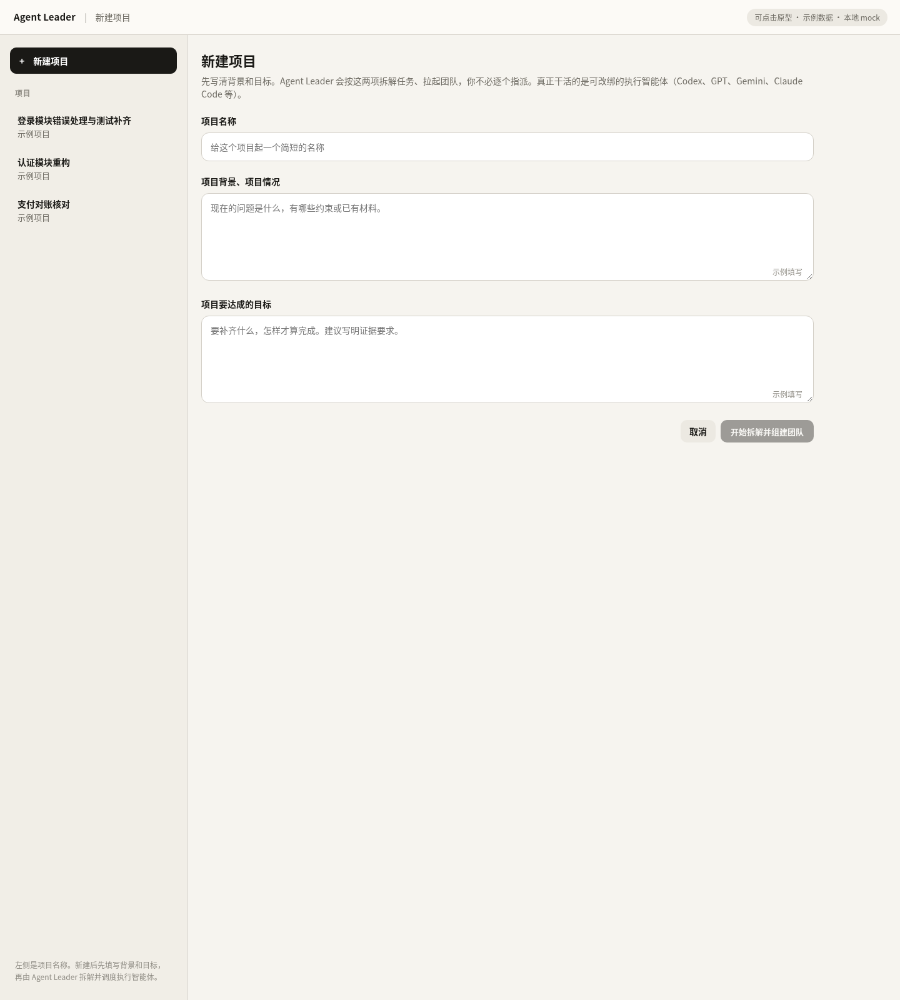

# Agent Leader

English | [中文](README.zh.md)

Agent Leader is a local, single-entry multi-agent orchestration system for individual developers on macOS and Windows.

It runs as a **local client/server dual-process** architecture: a read-only **Leader Brain** decomposes goals into staged DAG tasks and adjudicates outcomes against objective workspace evidence, while a self-hosted **Provider Runtime** drives locally installed coding agent CLIs across 48 built-in/ACP providers and isolated Git Worktrees.

Documentation: [docs/README.md](docs/README.md)

## Developer preview

Agent Leader is in _developer preview_ and iterating rapidly. **THERE WILL BE COMPATIBILITY-BREAKING CHANGES.**

The local daemon binds strictly to `127.0.0.1` with Host/Origin checks, secret redaction, high-risk command classification, single-writer handoff locks, and optional Git Worktree isolation. Review the [system architecture specification](docs/03-系统架构方案-v0.3/Agent-Leader-系统技术架构与实施规划-v0.3.md) before running autonomous tasks against production repositories.

## Run

### Run from source

Install `Node.js` 22.5+ (required for built-in `node:sqlite`), then run from a repository checkout:

```sh
git clone https://github.com/pgjeffrey/agent-leader.git
cd agent-leader
npm install
npm run dev
```

The command starts the local daemon at `http://127.0.0.1:6868` and the Web workbench at `http://127.0.0.1:5173` in one terminal. If port `6868` is occupied, the launcher automatically probes the next available port on `127.0.0.1`, syncs it to the Vite `/api` and `/ws` proxies, and writes the active port to `daemon.lock.json` under `~/.agent-leader` (macOS) or `%APPDATA%\AgentLeader` (Windows).

Set `AGENT_LEADER_PORT` to override the preferred daemon port and `AGENT_LEADER_HOME` to change the local state directory. On startup, the daemon auto-detects installed local CLIs (such as `codex`, `claude`, `agy`, `cursor-agent`, and `opencode`) for read-only orchestration and execution; if none are installed, it falls back to local heuristic rules and the built-in `mock` simulator so the full workflow can still be exercised offline without API keys.

### Run services separately

To start the daemon and Web workbench in separate terminals:

```sh
npm run dev:daemon
npm run dev:web
```

Keeping the daemon separate from the Web client ensures refreshing or closing the browser does not terminate active agent child processes.

## Screenshots

| Workbench | Task Detail & Structured Review |
| --- | --- |
|  |  |

| Handoff Package Confirmation | New Project Planning |
| --- | --- |
|  |  |

## Architecture

Agent Leader is organized as a TypeScript monorepo with four workspace packages:

- `packages/protocol`: Shared domain entities, Zod schemas, WebSocket events, and the 48-provider catalog (6 native, 6 built-in plugins, 36 ACP catalog) plus custom ACP extensions.
- `packages/daemon`: Local `127.0.0.1` HTTP/WebSocket daemon containing `LeaderBrain`, DAG `Orchestrator`, objective `EvidenceCollector`, `WorktreeManager`, `ProviderRuntime`, and SQLite persistence.
- `packages/web`: React + Vite local workbench for stage tracking, live agent streams, project facts, 10-field handoff confirmations, and approval inbox management.
- `packages/desktop`: Cross-platform desktop bootstrapper for macOS and Windows that discovers or spawns the local daemon via `daemon.lock.json` and `/api/health`.

## Development

Start with the [documentation index](docs/README.md), [PRD v0.2](docs/01-产品需求文档-PRD-v0.2/Agent-Leader-产品需求文档-PRD-v0.2.md), [architecture and roadmap v0.3](docs/03-系统架构方案-v0.3/Agent-Leader-系统技术架构与实施规划-v0.3.md), and [multi-agent runtime specification](docs/multi_agent_control_and_data_return_plan.md).

Run workspace checks, tests, and production builds:

```sh
npm run typecheck
npm test
npm run build
```

`npm run typecheck` checks all four packages strictly, `npm test` runs the Vitest unit and end-to-end daemon integration suite, and `npm run build` compiles `protocol`, `daemon`, `web`, and `desktop` in dependency order.

## Contributing

Contributions, bug reports, and provider catalog additions are welcome. Follow Conventional Commits (`type(scope): description`) and run `npm run typecheck` and `npm test` before submitting changes.

## License

[Apache-2.0](LICENSE)
