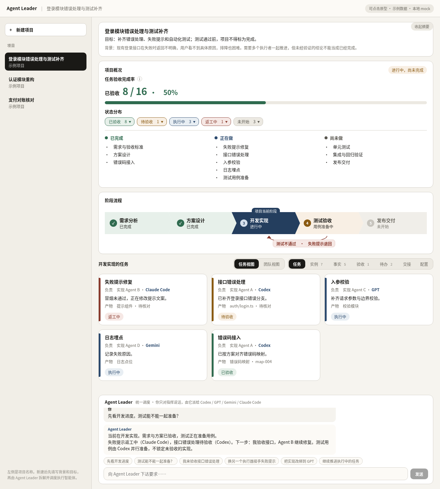
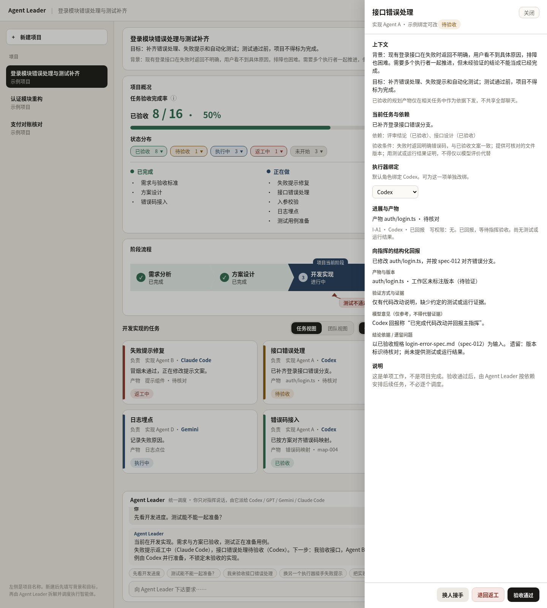
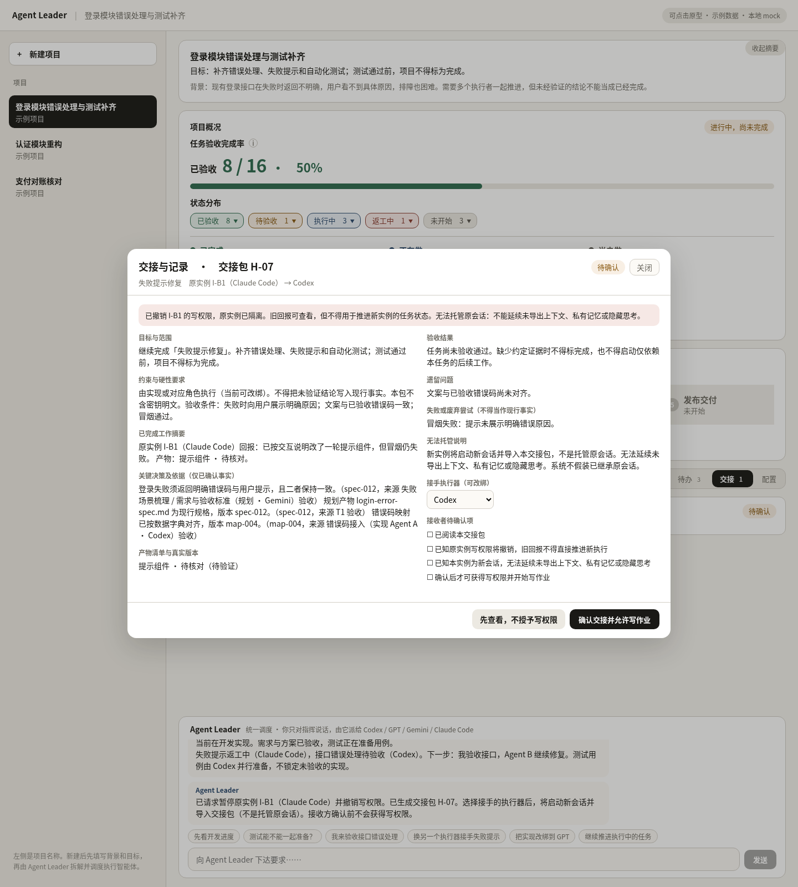
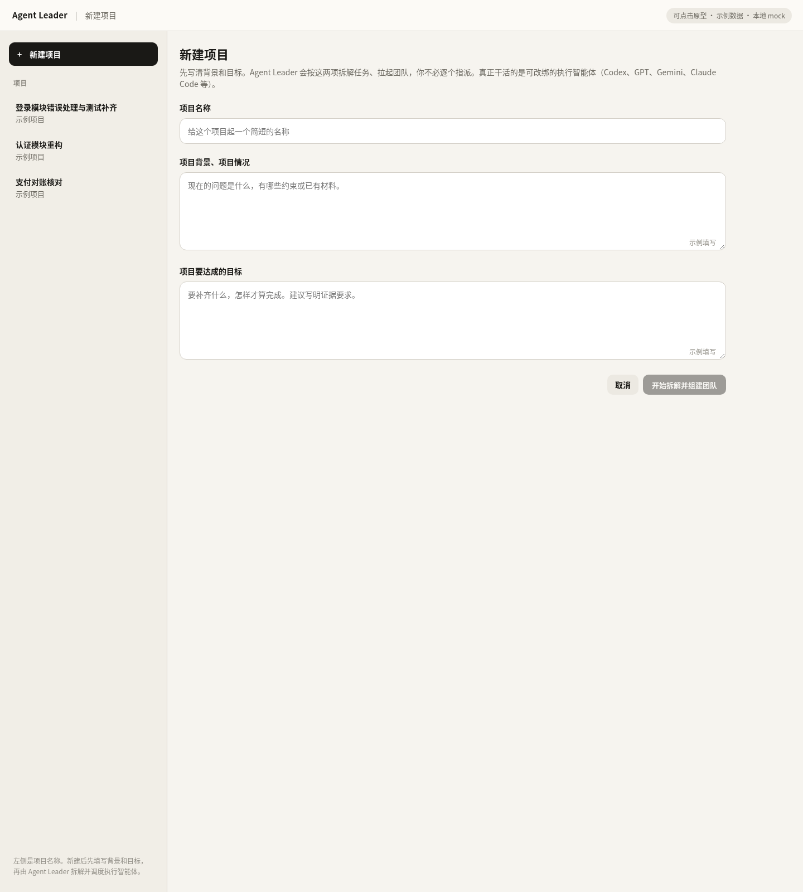

# Agent Leader

[English](README.md) | 中文

Agent Leader 是一款运行在 macOS 与 Windows 本地环境、面向个人开发者的单一入口多智能体指挥系统。

项目采用**本地 C/S 双进程**架构：上层只读的 **Leader Brain（指挥大脑）** 负责按软件工程阶段拆解 DAG 任务并结合客观工作区证据做出裁决，下层自建的 **Provider Runtime（执行底座）** 通过本地守护进程与独立 Git Worktree 驱动本机已安装的编程智能体 CLI，内置 48 款开箱/ACP 智能体及自定义扩展。

文档中心：[docs/README.md](docs/README.md)

## 开发预览

Agent Leader 目前处于 _开发预览（developer preview）_ 阶段，正在快速迭代。**后续更新可能包含破坏兼容性的变更。**

本地守护进程严格仅监听 `127.0.0.1`，内置 Host/Origin 校验、敏感信息脱敏、高风险命令识别、换人防双写状态锁以及可选的 Git Worktree 隔离。在生产代码仓库上启用自治执行前，请先阅读[系统技术架构与实施规划](docs/03-系统架构方案-v0.3/Agent-Leader-系统技术架构与实施规划-v0.3.md)。

## 运行

### 从源码运行

安装 `Node.js` 22.5+（使用内置 `node:sqlite`，零原生编译依赖），克隆仓库后运行：

```sh
git clone https://github.com/pgjeffrey/agent-leader.git
cd agent-leader
npm install
npm run dev
```

该命令会在同一终端启动本地守护进程（默认 `http://127.0.0.1:6868`）与 Web 工作台（默认 `http://127.0.0.1:5173`）。若 `6868` 端口被占用，启动脚本会自动顺延探测 `127.0.0.1` 上的可用端口，同步注入 Vite 的 `/api` 与 `/ws` 代理，并将实际端口写入 `~/.agent-leader/daemon.lock.json`（macOS）或 `%APPDATA%\AgentLeader\daemon.lock.json`（Windows）。

可通过环境变量 `AGENT_LEADER_PORT` 指定首选守护进程端口，通过 `AGENT_LEADER_HOME` 自定义本地数据目录。启动时守护进程会自动探测本机已安装并完成认证的 CLI（如 `codex`、`claude`、`agy`、`cursor-agent`、`opencode` 等）用于只读指挥与任务执行；若未安装外部 CLI，则自动回退到本地启发式规则与内置 `mock` 模拟器，无需配置 API Key 即可离线演练完整闭环。

### 分别运行服务

如需在不同终端分别启动守护进程与 Web 工作台：

```sh
npm run dev:daemon
npm run dev:web
```

前后端进程分离后，刷新或关闭浏览器页面不会中断守护进程托管的后台智能体子进程。

## 界面预览

| 工作台主视图 | 任务详情与结构化验收 |
| --- | --- |
|  |  |

| 标准交接包确认 | 新建项目与阶段拆解 |
| --- | --- |
|  |  |

## 架构概览

Agent Leader 采用 TypeScript 单仓 Monorepo 组织，包含四个工作区包：

- `packages/protocol`：前后端共享领域实体、Zod 校验契约、WebSocket 事件以及 48 款内置执行智能体清单（6 款核心原生、6 款内置扩展、36 款 ACP 目录）与自定义 ACP 扩展定义。
- `packages/daemon`：仅监听 `127.0.0.1` 的本地 HTTP/WebSocket 守护服务端，集成 `LeaderBrain`、DAG `Orchestrator`、客观证据采集器 `EvidenceCollector`、`WorktreeManager`、`ProviderRuntime` 与 SQLite 持久化存储。
- `packages/web`：基于 React + Vite 的本地工作台前端，提供阶段流转视图、实例实时流监控、共享项目事实库、10 字段交接包确认与待办审批中心。
- `packages/desktop`：面向 macOS 与 Windows 的桌面端宿主启动器，通过 `daemon.lock.json` 与 `/api/health` 身份指纹自动探测复用或无黑框拉起本地守护进程。

## 开发

建议从[项目文档中心](docs/README.md)、[产品需求文档 PRD v0.2](docs/01-产品需求文档-PRD-v0.2/Agent-Leader-产品需求文档-PRD-v0.2.md)、[系统技术架构与实施规划 v0.3](docs/03-系统架构方案-v0.3/Agent-Leader-系统技术架构与实施规划-v0.3.md) 以及[多 Agent 统一控制与数据回传专项规范](docs/multi_agent_control_and_data_return_plan.md)入手。

常用工程检查、测试与构建命令：

```sh
npm run typecheck
npm test
npm run build
```

`npm run typecheck` 执行全仓四包严格类型检查，`npm test` 运行 Vitest 单元与守护进程端到端集成测试，`npm run build` 按依赖顺序编译构建 `protocol`、`daemon`、`web` 与 `desktop`。

## 参与贡献

欢迎提交问题反馈、代码改进与新的 ACP 智能体目录配置。提交变更请遵循 Conventional Commits 规范（`type(scope): description`），并在提交前确保 `npm run typecheck` 与 `npm test` 全部通过。

## 许可证

[Apache-2.0](LICENSE)
