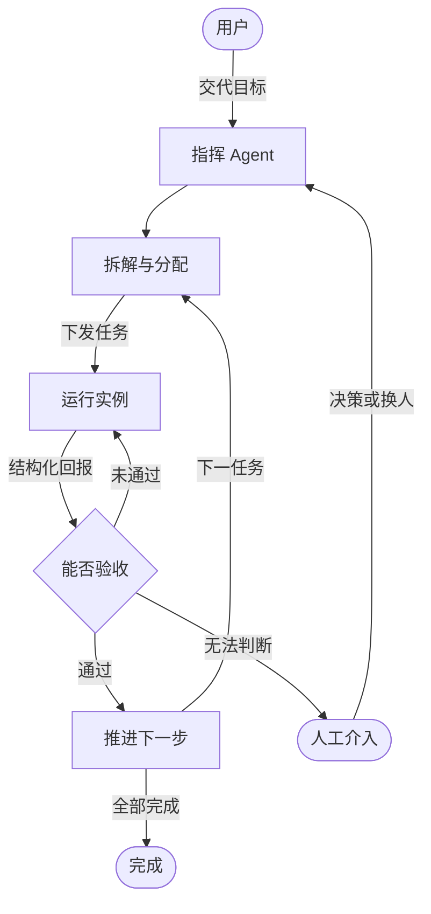
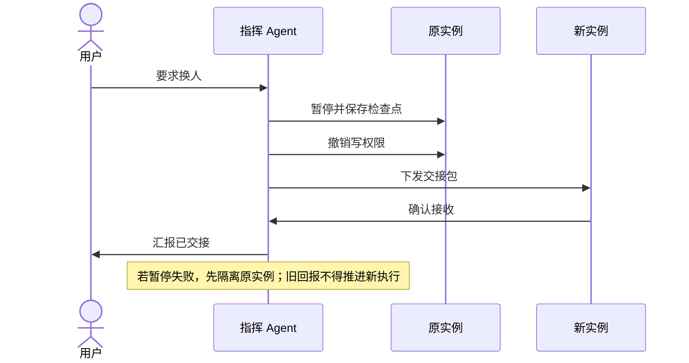

> 本文是 Cursor Page「指挥 Agent 产品需求文档 PRD v0.1」的 Markdown 导出，便于离线阅读，未改写需求原文。原件见同目录 `source.canvas.tsx`。
>
> - 作者：产品经理
> - Canvas：[指挥 Agent 产品需求文档 PRD v0.1](https://cursor.com/canvas/store-677ff2fa-7a30-4969-b3db-3d9af3954dbf/c5339b29-2ec5-4fda-b7bd-4f3565921bfe)
> - canvas_id：`c5339b29-2ec5-4fda-b7bd-4f3565921bfe`
> - 页面更新：2026年11月24日 12:54（Asia/Shanghai）

---

# 指挥 Agent 产品需求文档

待评审草案：用单一入口指挥多个执行器协作、验收与交接，解决并行开发中重复解释和无法接力的问题。本文不是已验证的集成方案。

## 目录

- [文档说明](#intro)
- [产品定位与非目标](#positioning)
- [已确认需求与建议假设](#confirmed)
- [用户场景](#scenarios)
- [核心概念](#concepts)
- [版本范围](#scope)
- [核心流程](#flow)
- [功能需求](#requirements)
- [配置与约束](#config)
- [项目事实与交接包](#handoff)
- [换人、工作区与状态](#switch)
- [界面信息架构](#ia)
- [权限与安全](#security)
- [建议指标与验收案例](#acceptance)
- [待确认问题](#open-questions)

## 文档说明 {#intro}

> **待评审草案，不是已验证的集成方案** 这是 PRD v0.1，供产品、设计与架构评审。它描述目标能力与可检验验收条件，不是实现承诺。跨提供方调用、已有会话托管、运行中任务暂停与写权限回收等技术可行性尚未验证，正文已标注。

| 字段 | 值 |
| --- | --- |
| 版本 | v0.1 |
| 状态 | 待评审草案 |
| 日期 | 2026年11月24日（Asia/Shanghai） |
| 读者 | 产品、设计、架构评审 |

以下技术点的可行性尚未验证，不得当成已有能力：目标执行器是否提供稳定可程序化的控制接口；已有会话是否可被托管；运行中实例是否可被可靠暂停并撤销写权限；交接包能否在不导入私有会话的前提下完成等价接力；工作区隔离与冲突检测的可落地程度取决于最终形态与仓库工具链。

## 产品定位与非目标 {#positioning}

本产品是面向个人开发者的单一交互入口指挥 Agent。用户只向它交代目标、补充要求或调整方向；由它理解目标、拆成带依赖的步骤、按可配置分工分给不同提供方及其多个运行实例，在收到结构化结果后自行验收，通过后再推进，判断不了或需要干预时停下来问人。指挥 Agent 不一定亲自写代码，但必须知道每项工作推进到哪里、依据是什么。

首要痛点是：多个 Agent（即使全是同一提供方的多个实例）并行工作时彼此不知进展，用户切换时必须重复解释。产品的核心价值不是把任务转发给多个聊天窗口，而是让不同执行者能基于同一份可靠的项目状态接着彼此的工作做下去，并对完成与否负责。跨提供方调度与可定制分工是总体愿景，不因首版收窄而取消。

首版非目标如下。

- 不做通用多 Agent 管理平台、多租户或团队协作空间。
- 不做各提供方聊天窗口的简单聚合。
- 不承诺导入各提供方的私有会话，也不承诺获取模型隐藏思考。
- 不把某一模型或提供方的能力写死为产品规则。
- 工作区与冲突处理按个人单项目并行开发设计，不按生产级分布式系统规格编写。

## 已确认需求与建议假设 {#confirmed}

下表区分用户已明确表达的需求，以及为推进首版而建议、尚待确认的假设。建议假设不是已定需求，评审后可改。

| 条目 | 性质 |
| --- | --- |
| 用户只通过单一入口与指挥 Agent 交互 | 已确认 |
| 将目标拆解为带依赖的步骤，并按配置分给不同提供方和多个实例 | 已确认 |
| 分工必须可定义、可定制，不能固化某模型的能力 | 已确认 |
| 收到结果后要自行验收再推进；判断不了则请人介入 | 已确认 |
| 可随时让另一执行器接手，并交接目标、上下文与文件等 | 已确认 |
| 同一提供方的多实例并行时，也要能协作与交接 | 已确认 |
| 先面向个人开发者自用，而不是团队产品 | 建议假设 |
| 先做单项目、多工作区，以同仓库协作为主场景 | 建议假设 |
| 产品形态（CLI、API、桌面或编辑器插件）待定 | 建议假设 |
| MVP 采用默认绑定策略，换人以手动为主 | 建议假设 |
| MVP 以两种执行器作为接入验证目标，不承诺现有产品已可 API 控制 | 建议假设 |

## 用户场景 {#scenarios}

以下三个场景是首版应优先覆盖的核心用途。场景中的角色分工仅为可配置示例，不是产品写死的能力划分。执行器不限于某一家；用户提到的其他模型或工具一律视为可配置的执行器候选，产品不预设其能力边界。

| 场景 | 用户做什么 | 系统做什么 |
| --- | --- | --- |
| 同提供方多实例并行 | 开多个执行实例并行开发，只向指挥 Agent 交代目标或调整方向。 | 维护谁在做什么、改了什么、哪些结论已确认。实例开工前只拿与自己相关的最新事实；结束后交回产物、验证与遗留问题。后续任务或新实例无需用户再讲一遍。 |
| 规划后由另一执行器实现 | 配置某角色负责文档、规划与梳理，另一角色负责具体实现；也可随时改绑。 | 按配置分配任务。规划通过验收后再进入实现；实现方收到规划产物的真实版本，而不是聊天转述。 |
| 人为换人接手 | 看到当前质量不佳，要求换另一执行器接着做。 | 先暂停原任务、保存检查点、撤销写权限，再生成交接包给新实例。新实例确认后再写。若原实例停不下来，则隔离之，其后续回报不得推进新执行。 |

## 核心概念 {#concepts}

| 概念 | 定义 |
| --- | --- |
| 指挥 Agent | 用户唯一交互对象。负责理解目标、拆解任务、按配置分配、验收成果、维护项目状态并安排交接。 |
| 提供方 | 可接入的外部 Agent 或模型服务方。产品不预设某一家的能力边界。 |
| 模型 | 某提供方下可被绑定到角色的具体模型或工程。 |
| 角色配置 | 用户可定义的职责，如规划与文档、实现、审查，并绑定提供方、模型与工具权限。可改、可替换。 |
| 运行实例 | 为执行某个任务而启动或尝试托管的一次具体执行。与任务是不同对象。 |
| 任务 | 带依赖、验收条件与角色归属的工作单元。一个任务可对应多次运行实例。 |
| 项目状态 | 共享且可追溯的项目事实集：条目、版本、来源与状态。它是接力的依据，不等于聊天记录。 |
| 产物 | 任务产出的可核对对象，如文件、文档、测试结果。必须带真实版本标识。 |
| 验收 | 按事先约定的条件检查任务是否完成。客观证据优先于模型意见。 |
| 交接包 | 为接手方准备的结构化上下文，含目标、约束、已完成工作、决策、产物版本、验收与遗留问题等。 |

## 版本范围 {#scope}

总体愿景是：用户只对指挥 Agent 交互，系统可配置地调度多种提供方与多个运行实例，支持跨角色接力与人工换人，并对完成与否负责。首版只验证这一闭环的最小可用切面，不收缩该愿景。

| 范围 | 包含 | 说明 |
| --- | --- | --- |
| P0 / MVP | 统一入口；任务拆解与依赖调度；角色与默认绑定；两种执行器接入验证；结构化回报与客观验收；项目事实；交接包；手动换人（暂停、检查点、回收写权限、必要时隔离）；人工阻塞；区分新会话启动与已有会话托管。 | 单项目多工作区为建议假设。无法托管已有会话时，只导入交接包并标明能力缺口。不承诺现有产品已可被 API 稳定控制。 |
| P1 | 执行者自动建议（硬约束优先）；预算与重试阈值落地；并行文件冲突检测增强；角色模板；更多可自动执行的验收。 | 在 MVP 闭环稳定后增强，不改变核心交接与验收原则。 |
| 后续 | 跨项目；团队协作；更多执行器；更强的已有会话托管；更复杂的并行编排。 | 属于总体愿景的展开，不因首版未做而从需求中删除。 |

## 核心流程 {#flow}

1. **用户下达目标**
   只向指挥 Agent 交代目标、补充约束或调整方向。
2. **拆解为带依赖的任务**
   每个任务带验收条件与角色归属；未满足依赖的不得开工。
3. **按配置分配**
   依角色与默认绑定选择执行器；用户硬约束优先于自动建议。
4. **启动或尝试托管实例**
   下发局部上下文与相关项目事实。若无法托管已有会话，则启动新会话并仅导入交接包。
5. **收到结构化结果**
   实例交回已做工作、产物版本、验证证据、遗留问题与废弃尝试。
6. **验收并决定是否推进**
   客观证据优先；不能证明则不标完成，进入返工、换人或人工阻塞。通过则推进依赖后续任务。

## 功能需求 {#requirements}

每项需求带编号与可检验的验收条件。下方筛选只改变本页阅读视图，不会修改需求本身。

页面筛选（仅改变阅读视图，不修改原文）：全部（17） · P0（13） · P1（2） · 后续（2）。以下导出列出全部内容。

| 编号 | 范围 | 需求 | 验收条件 |
| --- | --- | --- | --- |
| FR-01 | P0 | 用户只通过指挥 Agent 下达目标、补充约束、查看进展、批准、换人与介入。 | 主路径中，用户不必向执行实例重复交代项目全貌。 |
| FR-02 | P0 | 将目标拆成带依赖与验收条件的任务；未满足依赖的任务不得开工，任务可被取消。 | 含先后依赖的目标中，前置任务未验收通过前，后续任务保持不可执行。 |
| FR-03 | P0 | 用户可定义角色并绑定提供方、模型与工具权限；绑定可随时修改。产品不得写死某模型只能做某类工作。 | 同一项目可将规划与实现角色对调或改绑到其他执行器，系统按新配置分配。 |
| FR-04 | P0 | MVP 以两种执行器为接入验证目标，并区分“启动新会话”与“托管已有会话”。不承诺现有产品已可被 API 稳定控制（技术可行性未验证）。无法托管时只导入交接包，并标明无法延续未导出上下文、私有记忆或隐藏思考。 | 两种模式都展示能力边界；无法托管时系统不假装已继承原会话。 |
| FR-05 | P0 | 运行实例结束或阶段完成时，必须交回结构化结果：已做工作、产物与真实版本、验证方式与证据、结论依据、遗留问题、失败或废弃尝试。 | 仅回复“完成了”且缺少产物版本与验证信息时，任务不得进入已完成。 |
| FR-06 | P0 | 事先约定验收条件。能用测试、文件或运行结果等客观证据证明的，不得以另一模型的主观评价代替。模型意见可作参考，须与证据分开记录。不能证明则不得标完成。 | 缺少约定证据的任务，在状态与界面上均不得显示为已完成。 |
| FR-07 | P0 | 维护共享项目事实：条目、版本、来源与状态。实例只获得与任务相关的局部上下文，不共享全部聊天。失败、过期或废弃方案须单独标记，不得作为现行事实下发。 | 废弃方案不出现在后续实例的现行事实中；聊天记录可作依据，但不自动成为事实。 |
| FR-08 | P0 | 换人、任务交接或无法托管原会话时，生成交接包。不承诺导入各提供方的私有会话或模型隐藏思考。 | 接收实例开工写作业前须确认交接包；产物可核对到具体版本标识。 |
| FR-09 | P0 | 用户要求换执行者时，先请求暂停原任务、写入检查点并撤销写权限，再向新实例下发交接包。若暂停失败，必须隔离原实例。原实例之后的回报不得推进新执行。暂停与写权限回收的可靠度尚未验证。 | 换人过程中不会有两个实例同时拥有有效写权限；隔离后的旧回报不改变新任务状态。 |
| FR-10 | P0 | 并行任务应尽量工作区隔离。若可能改到相同文件或集成点，调度应避免并行或先提示用户。合入或任务完成前需做集成验证。本项按个人单项目并行开发设计，不按生产级分布式一致性规格实现。 | 系统能检出或预先提示明显的同文件并行写入风险，并在集成点要求验证。 |
| FR-11 | P0 | 任务状态与运行实例状态分开记录，均可取消。失败可按配置重试，超过阈值则阻塞或失败，不无限自动重试。断连恢复须去重。人工阻塞时不得自动推进依赖后续任务。 | 取消、失败、断连重连与人工阻塞四条路径下，状态一致，且在可观察范围内无重复执行副作用。 |
| FR-12 | P0 | 指挥入口须能展示：当前目标、任务依赖与状态、各实例进展、项目事实与产物版本、验收依据、待批准或待介入项、交接与换人记录。本项是信息架构要求，不规定仿照某一现有产品的界面。 | 上述信息无需进入执行器原生界面，也能在指挥入口中查看。 |
| FR-13 | P0 | 工具权限按角色配置。涉及敏感信息、破坏性命令、发布或对外提交的操作，须经用户批准后才可执行。密钥与凭据不得写入项目事实或交接包正文。 | 未批准的发布或高风险命令不会被执行；交接包中无密钥明文。 |
| FR-14 | P1 | 系统可根据角色配置或历史效果建议执行者，但用户设定的硬约束始终优先；自动建议不得覆盖硬约束。 | 已禁止某提供方执行某类任务时，建议与实际分配都不会违反该约束。 |
| FR-15 | P1 | 用户可配置并发上限、预算阈值与重试阈值。达到阈值应停止自动推进并通知用户。预算的具体计量方式待形态与接入方式确定，本需求不预设费用数字。 | 达到用户设定的并发或重试上限后，系统不再启动新的自动执行。 |
| FR-16 | 后续 | 支持在多个项目之间引用或迁移已确认事实、产物与交接，进行跨项目调度。 | 一个项目中的已确认事实与产物可被另一项目任务引用，且来源与版本可追溯。 |
| FR-17 | 后续 | 在技术验证通过后，将用户已有执行会话纳入持续托管，而不仅是一次性导入交接包。技术可行性未验证。 | 被托管会话的后续产出能同步回项目事实，能力边界不再仅限于一次性导入。 |

## 配置与约束 {#config}

分工、权限与阈值都必须可配置。用户可设定某角色负责规划与文档、另一角色负责实现，也可改绑到其他执行器。MVP 建议采用默认绑定策略加手动换人；自动建议属于 P1。凡自动建议与用户硬约束冲突时，硬约束优先。

| 配置项 | 说明 | 首现 |
| --- | --- | --- |
| 角色定义 | 用户可增删改角色及其职责说明。规划与文档、实现、审查仅为示例。 | P0 |
| 默认绑定 | 角色到提供方与模型的默认映射，可随时修改。 | P0 |
| 工具权限 | 按角色配置可读、可写、命令、网络等权限。 | P0 |
| 并发上限 | 同一项目下可同时运行的实例数量上限。 | P0 可配，P1 强制执行 |
| 预算阈值 | 如调用次数或费用上限的占位配置。计量方式待定，不预设数字。 | P1 |
| 重试阈值 | 失败后自动重试的次数上限，超过后阻塞并通知用户。 | P0 可配，P1 完善 |
| 硬约束 | 用户明确禁止或指定的分配规则，优先于任何自动建议。 | P0 手工生效，P1 接入建议逻辑 |

## 项目事实与交接包 {#handoff}

接力不依赖于共享全部聊天记录，而是基于同一份可靠的项目事实。聊天可保留作依据，但过期方案、未经验证的结论和失败尝试不能直接当成事实传下去。事实条目至少包含内容、版本、来源与状态；状态包括已确认、待验证、已废弃、失败教训。后两类只可作为教训或避开项单独下发，不得混入现行事实。

交接包是换人、任务接力或无法托管已有会话时的标准输出。它不等于导入对方的私有会话。接收实例在开始写作业前必须确认已看过交接包，并能核对产物的真实版本。

| 字段 | 要求 |
| --- | --- |
| 目标与成功标准 | 接手方要继续达成什么，以及怎样算完成。 |
| 约束与硬性要求 | 不可违反的限制、用户硬约束与已批准的决策。 |
| 已完成工作摘要 | 仅记已经验收或可核对的工作，不把进行中猜测当事实。 |
| 关键决策及依据 | 记录为何如此选择，以及依据来源。 |
| 产物清单与真实版本 | 路径、修订标识与时间等可核对信息。版本权威（如 Git 提交或工作区快照）待确认。 |
| 验收结果 | 通过、未通过或尚未验收，以及对应证据。 |
| 未解决问题 | 接手方必须看到的未完工与风险。 |
| 已废弃或失败方案 | 必须分列，明确标记为非现行事实，避免污染下一步工作。 |
| 建议下一步 | 供接手方参考，不得写成已确认事实。 |
| 接收者待确认项 | 接收实例开工写作业前必须确认的清单。 |

## 换人、工作区与状态 {#switch}

手动换人是 MVP 必须做稳的路径。目标是：用户说一句“换另一个执行器接着做”，无需再解释前面发生了什么。

若原实例停不下来，必须将其隔离：后续写入视为无效，且不再拥有有效写权限。隔离后仍产出的回报不得用来推进新实例的任务状态。该路径依赖的暂停与权限回收能力尚未验证，若接入层做不到，首版必须退回到隔离并明确告知用户。

并行任务应尽量使用独立工作区。若调度发现可能写入相同文件或共享集成点，应避免并行或提前询问用户。任务完成或合入前需进行集成验证。这些要求按个人开发者在单项目内并行工作来设计，不作为生产级分布式一致性规范。

| 对象 | 状态 |
| --- | --- |
| 任务 | 待拆解、待分配、待依赖、进行中、待验收、已完成、失败、已取消、人工阻塞 |
| 运行实例 | 待启动、启动中、运行中、暂停中、已暂停、已隔离、已完成、失败、断连、已取消 |

任务与运行实例的状态必须分开记录。一个任务可经历多次实例（重试或换人），不能用实例已结束代替任务已验收。断连恢复时须按指令去重，避免同一指令被执行两次。

## 界面信息架构 {#ia}

以下是指挥入口应该让用户看到和操作到的信息结构，不是界面视觉设计，也不规定仿照任何现有产品。最终形态（CLI、API、桌面或插件）待定，但信息架构应保持稳定。

| 信息区 | 用户在这里做什么 |
| --- | --- |
| 目标与对话 | 下达目标、补充约束、调整方向，并看到指挥 Agent 的回复与请求。 |
| 任务与依赖 | 查看拆解结果、依赖关系、任务状态，取消或调整任务。 |
| 运行实例 | 看各实例正在做什么、归属哪个任务、是否暂停、隔离或断连。 |
| 项目事实与产物 | 查看已确认事实、产物路径与真实版本、来源与状态。 |
| 验收与证据 | 查看验收条件、客观证据与模型意见的区分，以及未通过原因。 |
| 待办与批准 | 处理人工阻塞、高风险命令或发布批准、需要人判断的验收。 |
| 交接与记录 | 查看换人记录、交接包内容与接收确认。 |
| 配置 | 管理角色、默认绑定、工具权限、并发与重试阈值、硬约束。 |

## 权限与安全 {#security}

- 工具权限按角色配置，默认应尽量收窄；扩权需可追溯。
- 涉及敏感信息读取、破坏性命令、依赖安装、推送、发布或对外提交的操作，必须先经用户批准。默认批准策略待确认。
- 密钥、凭据和登录信息不得写入项目事实或交接包正文；执行器若需凭据，应走独立的秘密渠道，而不是随上下文下发。
- 交接包与项目事实应可被用户查看和审计，但不得因此暴露敏感材料。

## 建议指标与验收案例 {#acceptance}

以下指标是建议的产品目标，用于后续评估首版是否值得继续。它们不是已有测量，本文也不预设数值目标。

| 建议指标 | 看什么 |
| --- | --- |
| 换人后的重复解释 | 用户是否还要把关键上下文再讲一遍。目标是关键信息无需复述。 |
| 误标完成 | 已标记为完成、后又被推翻的任务占比。 |
| 人工介入 | 介入次数及原因，用于判断是验收过严还是分工不清。 |
| 交接一次确认即可开工 | 接收实例确认交接包后，是否还能直接开始写作业。 |
| 并行冲突返工 | 因同文件或集成点冲突导致的返工次数。 |

端到端验收案例如下，用于判定 MVP 是否成立。

| 案例 | 通过条件 |
| --- | --- |
| 多实例并行后接力 | 两个实例完成不同任务后，第三个实例仅靠项目事实与交接继续；用户不用复述全貌。 |
| 规划后实现 | 规划产物经验收后，实现实例拿到真实版本并完成实现任务的客观验收。角色绑定可被用户改掉。 |
| 中途换人 | 暂停或隔离成功，新实例确认交接包后继续；旧回报不影响新任务状态；两侧不会同时拥有有效写权限。 |
| 无法验收 | 缺少约定证据时进入人工阻塞，不标完成，也不自动推进依赖后续任务。 |
| 无法托管已有会话 | 系统只导入交接包并启动新会话；界面明确标出无法延续未导出上下文、私有记忆或隐藏思考。 |

## 待确认问题 {#open-questions}

以下问题会影响首版边界与接入方式，建议在评审时优先回答。

| 编号 | 问题 |
| --- | --- |
| Q1 | 首版是否确认采用“个人自用 + 单项目多工作区”，以及是否以同仓库协作为主场景？ |
| Q2 | 产品形态优先做成 CLI、API、桌面应用还是编辑器插件？ |
| Q3 | MVP 验证的两种执行器，各自可接受的接入方式是什么？若暂时只能启动新会话、不能托管已有会话，是否接受以此发布首版？ |
| Q4 | 高风险操作（安装依赖、推送、发布、删除）的默认批准策略是什么？ |
| Q5 | 项目事实中“真实版本”以什么为权威：Git 提交、工作区快照，还是其他机制？ |

*— 回到顶部 —*
