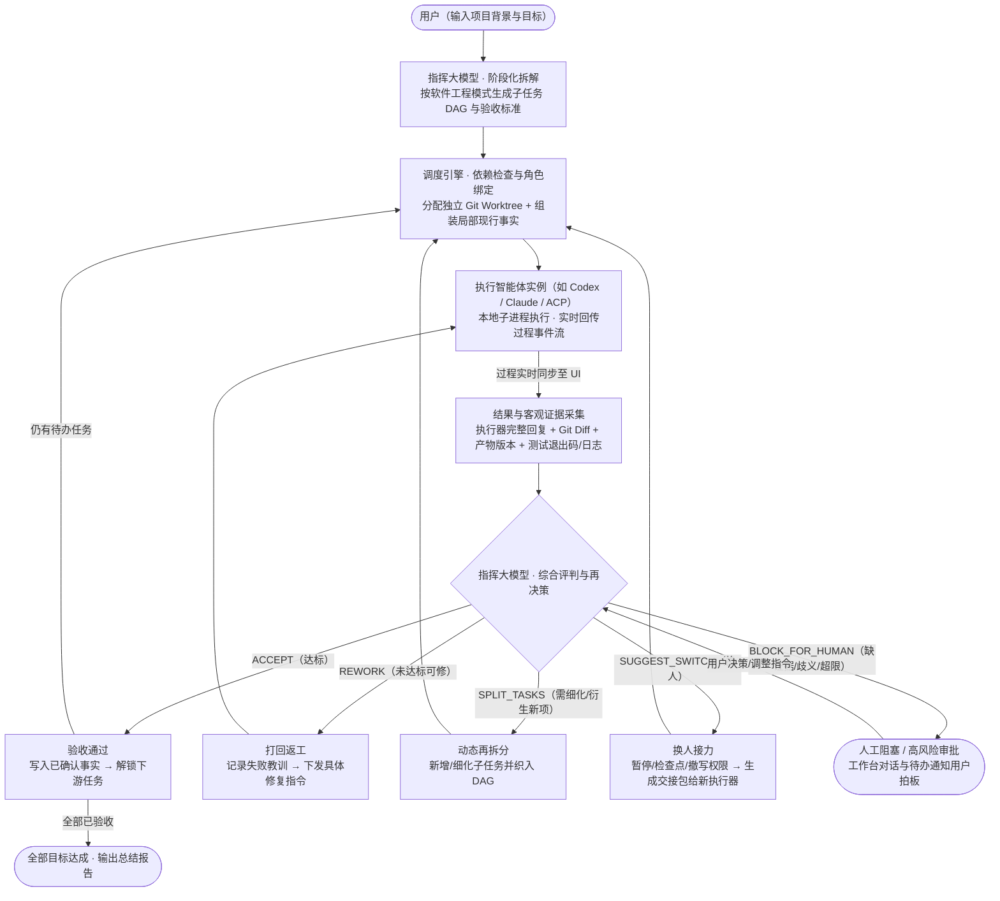
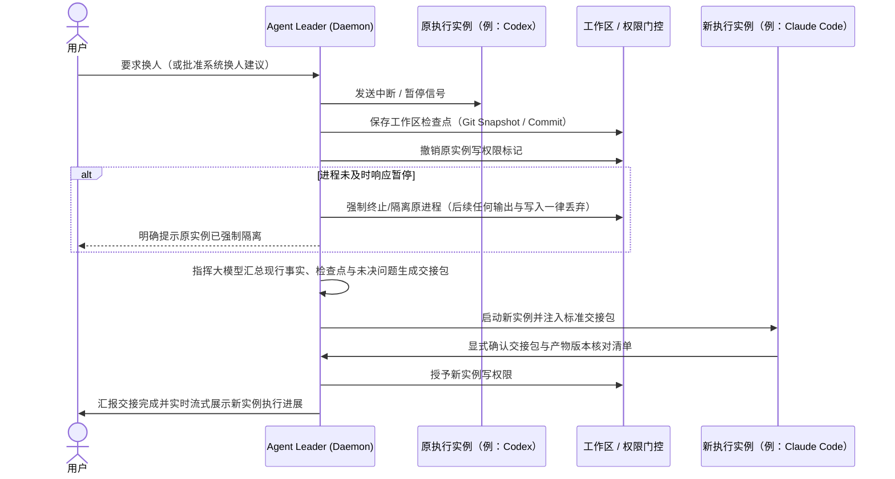

# Agent Leader 产品需求文档（PRD v0.2 · 已对齐基线版）

> **版本状态**：已对齐定稿（研发基线版）
> **项目名称**：Agent Leader
> **版本**：v0.2
> **更新日期**：2026年11月25日（Asia/Shanghai）
> **目标平台**：macOS、Windows（纯本地 C/S 双进程架构）
> **面向读者**：产品、设计、研发与架构实现

---

## 目录

- [1. 修订说明与立项基线](#1-修订说明与立项基线)
- [2. 产品定位、核心闭环与非目标](#2-产品定位核心闭环与非目标)
- [3. 目标用户与核心场景](#3-目标用户与核心场景)
- [4. 核心概念与状态模型](#4-核心概念与状态模型)
- [5. 后台指挥大模型（Leader Brain）调度机制](#5-后台指挥大模型leader-brain调度机制)
- [6. 可指挥执行智能体清单与接入体系](#6-可指挥执行智能体清单与接入体系)
- [7. 版本范围与演进路线](#7-版本范围与演进路线)
- [8. 核心运行与协同流程](#8-核心运行与协同流程)
- [9. 详细功能需求](#9-详细功能需求)
- [10. 项目事实、结构化回报与交接包规范](#10-项目事实结构化回报与交接包规范)
- [11. 界面信息架构（对齐原型 v0.8）](#11-界面信息架构对齐原型-v08)
- [12. 权限、安全与跨平台约束](#12-权限安全与跨平台约束)
- [13. 衡量指标与端到端验收标准](#13-衡量指标与端到端验收标准)
- [14. 已拍板产品与架构决策汇总](#14-已拍板产品与架构决策汇总)

---

## 1. 修订说明与立项基线

本需求书是在历史草案 [PRD v0.1](../01-产品需求文档-PRD-v0.1/指挥Agent-产品需求文档-PRD-v0.1.md)、[系统架构图 v0.2](../03-系统架构图-v0.2/Agent-Leader-系统架构图-v0.2.md) 与 [界面原型 v0.8](../04-界面样例/v0.8/README.md) 基础上，结合 Paseo 项目经验与最新产品决策重写的正式研发基线文档：

1. **自建执行底座（以 Paseo 为参考蓝本）**：不依赖、不直接调用 Paseo 代码库，而是借鉴其多智能体进程封装、实时事件流监控与 Git Worktree 工作区模型，独立自建属于 Agent Leader 的本地执行引擎。
2. **纯本地 C/S 双进程架构（支持 macOS 与 Windows）**：采用「本地守护服务端（Daemon）+ 本地客户端界面（Web / 桌面端）」双进程架构，仅通过本机回环网络通信；明确不做跨网远程控制、中继服务器（Relay）或移动端。
3. **确立后台指挥大模型（Leader Brain）驱动的闭环**：系统后台对接可配置的大模型专职负责指挥调度——按软件开发模式拆分子任务、调用 Codex 等执行智能体并实时监控过程、根据执行回复与客观证据判断结果（验收推进 / 打回返工 / 换人接力 / **动态进一步拆分新子任务** / 请求人工介入）。
4. **确立 48 款可指挥智能体 + 自定义扩展目标清单**：完整覆盖 6 款核心原生、6 款内置扩展、36 款标准 ACP（Agent Client Protocol）目录智能体，以及自定义兼容端点与任意 ACP 接入。

---

## 2. 产品定位、核心闭环与非目标

### 2.1 产品定位

**Agent Leader** 是一款运行在 **macOS 与 Windows 本地环境**、面向个人开发者的**单一入口多智能体指挥系统**。

系统严格分为两层：
- **指挥层（Agent Leader / 后台指挥大模型）**：用户的唯一交互对象。它**不亲自编写业务代码**，专职负责理解项目背景与目标、按软件工程模式拆解子任务、按可配置角色向外部执行智能体派工、实时监控执行过程、结合执行回复与客观证据做出验收与下一步决策（含返工、换人、动态追加拆分子任务）、维护共享项目事实库。
- **执行层（被指挥的外部编程智能体）**：在本机工作区（含独立 Git Worktree）中真正完成需求梳理、方案撰写、代码实现、审查与测试的本地 CLI 智能体（如 Codex、Claude Code、Antigravity、Cursor、Gemini CLI、TRAE CLI、Qwen Code 等），直接复用用户本机已安装的开发环境、订阅凭据、技能与 MCP。

### 2.2 解决的核心痛点

1. **多实例并行开发的信息孤岛**：开多个智能体同时干活时，彼此不知道对方进展、改了哪些文件、哪些方案已经被废弃。
2. **中断与换人时反复解释**：某个智能体效果不好需要换人或返工时，用户不得不把项目背景、约束、已完成部分和踩过的坑重新复制粘贴讲一遍。
3. **缺少过程掌控与闭环再决策**：发完任务后要么黑盒等待，要么把执行器一句“我改好了”误当成真正完成，缺乏客观证据核验以及发现新问题后的自动返工或二次拆解机制。

### 2.3 明确的非目标

- **不做远程操控与跨设备云端同步**：不做公网/局域网远程访问、不做加密中继服务器（Relay）、不做 iOS/Android 移动端；所有服务端与客户端均运行在用户本地机器（macOS / Windows）。
- **不做多聊天窗口的简单聚合器**：不让用户分别去跟十几个智能体窗口逐个聊天。
- **不固化任何模型的能力边界**：不在代码里写死“某模型只能做规划、某模型只能写代码”，角色与执行器绑定完全开放可配。
- **不承诺继承提供方私有隐藏思考**：当执行器不支持恢复原会话时，坦诚采用「新会话 + 标准交接包」接力，并在界面明确标注能力边界。
- **不做多租户团队协作 SaaS**：聚焦个人开发者在本机项目中的多智能体高效协同。

---

## 3. 目标用户与核心场景

| 场景编号 | 核心场景 | 用户做什么 | 系统做什么 |
| --- | --- | --- | --- |
| **S1** | **新建项目与软件工程模式自动拆解** | 输入「项目背景」与「要达成的目标」（及项目目录）。 | 后台指挥大模型按软件开发阶段（需求分析 → 方案设计 → 开发实现 → 测试验收 → 发布交付）自动拆解出带依赖与验收标准的子任务图，并按默认角色准备拉起执行团队。 |
| **S2** | **派工执行与全过程实时监控** | 在工作台观察进度，或随时在底部与 Agent Leader 对话补充要求。 | 调度引擎调用对应执行器（如 Codex）在工作区/Git Worktree 中执行；实时捕获流式输出、命令执行、文件修改、审批请求与完成回报，全程透明可见。 |
| **S3** | **结果评判、返工与动态二次拆解** | 无需逐条人工盯梢，仅在关键节点或阻塞时介入拍板。 | 执行器（如 Codex）回报后，指挥大模型综合其回复内容与客观证据（测试结果、Git Diff、产物版本）自动裁决：达标则沉淀事实并推进下一步；不达标则自动下发返工指令；若发现遗漏或衍生新复杂度，**动态进一步拆分出新子任务**并排入调度。 |
| **S4** | **中途一键换人接力（零重复解释）** | 发现当前执行器卡壳或质量不佳，对 Agent Leader 说“换 Claude Code / Gemini 接着做”。 | 自动暂停/中断原实例、保存检查点、回收写权限（停不下来则强制隔离并作废后续回报），生成标准交接包发给新实例；新实例确认交接包后获得写权限继续开发。 |
| **S5** | **本机多工作区并行开发与合并前验证** | 下达包含多个独立模块的目标。 | 为无冲突的子任务自动分配独立 Git Worktree 分支并行推进；检测到同文件/集成点潜在冲突时自动串行化或预警提示，合入前执行集成测试验收。 |

---

## 4. 核心概念与状态模型

### 4.1 核心领域实体

| 实体 | 定义 | 关键规则 |
| --- | --- | --- |
| **Agent Leader（指挥大脑）** | 后台对接指挥大模型的调度中枢与用户唯一交互入口。 | 只做拆解、派工、监控、验收裁决、动态再规划、事实维护与交接，不直接改业务代码。 |
| **本地守护进程（Daemon）** | 运行在本机后台的服务进程（仅监听 `127.0.0.1`）。 | 托管状态库、指挥循环、Git Worktree 与所有执行器子进程；客户端关闭或刷新不影响正在执行的任务。 |
| **项目（Project）** | 绑定本机某个代码目录/Git 仓库的目标管理单元。 | 侧栏支持切换多个本地项目；每个项目拥有独立的任务图、事实库、角色配置与对话历史。 |
| **工作区（Workspace）** | 执行实例实际读写文件的目录容器（项目主目录 / 新建 Git Worktree / 已有 Worktree）。 | 并行写任务优先使用独立 Git Worktree 隔离，任务归档后可按需清理受管 Worktree。 |
| **执行智能体（Provider）** | 本机已安装并完成认证的外部编程智能体 CLI（如 Codex、Claude Code 及各类 ACP Agent）。 | 统一抽象为标准生命周期接口；支持可用性检测、版本查看与自定义扩展。 |
| **角色与配置模板（Role & Profile）** | 用户定义的职责（如需求/架构、编码实现、代码审查、测试验证），绑定 Provider、具体模型、思考强度、权限模式与工具边界。 | 支持随时修改绑定或针对单任务临时覆盖；用户硬约束高于一切自动推荐。 |
| **任务（Task）** | 带所属阶段、前置依赖（DAG）、角色归属、执行说明与明确验收条件的工作单元。 | 支持初始拆解生成，也支持指挥大模型在评判阶段**动态拆分新增、插入或取消**；**实例跑完 ≠ 任务完成**。 |
| **运行实例（Instance）** | 某任务下启动或恢复的一次具体执行器子进程会话。 | 一个任务可对应多次运行实例（返工重试或换人）；显式记录写权限状态与会话模式。 |
| **项目事实（Project Fact）** | 经确认可追溯的项目知识条目（内容、版本、来源、状态）。 | 下发给后续实例的唯一权威上下文，严格隔离「已确认现行事实」与「已废弃/失败教训」。 |
| **产物（Artifact）** | 任务产出的可核对实体（代码文件、设计文档、测试输出等）。 | 必须绑定真实版本标识（Git Commit SHA / Worktree Diff 快照 / 文件 Hash）。 |
| **交接包（Handoff Package）** | 跨角色传递、中途换人或降级接管时的 10 字段结构化交接单。 | 接收实例未确认交接包前不授予写权限；严禁包含任何明文密钥。 |

### 4.2 状态机定义

| 对象 | 核心引擎状态 | 工作台 v0.8 顶栏聚合展示映射 |
| --- | --- | --- |
| **任务（Task）** | `待拆解`、`待分配`、`待依赖`、`进行中`、`待验收`、`已验收（已完成）`、`返工中`、`失败`、`已取消`、`人工阻塞` | 全局量化统计归并为五种互斥主态：**已验收**、**待验收**、**执行中**、**返工中**、**未开始**；`人工阻塞`、`失败`、`已取消` 独立醒目提示，绝不计入完成率。 |
| **运行实例（Instance）** | `待启动`、`启动中`、`运行中`、`暂停中`、`已暂停`、`待确认交接包`、`已回报`、`已隔离`、`已完成`、`失败`、`断连`、`已取消` | 显式标注当前执行器、实时动作摘要、会话模式（新会话/恢复会话/交接导入）及**写权限开关**。 |
| **项目事实（Fact）** | `已确认`、`待验证`、`已废弃`、`失败教训` | 仅 `已确认` 作为现行事实注入执行提示词；后两类仅作为「避坑项」独立展示与传递。 |

---

## 5. 后台指挥大模型（Leader Brain）调度机制

后台指挥大模型是 Agent Leader 的核心决策引擎，采用**事件驱动循环**工作：

### 5.1 模型配置要求
- 支持对接任意 **OpenAI 兼容接口**（如 OpenAI、DeepSeek、本地兼容网关等）以及 **Anthropic 官方 API**、**Google Gemini 官方 API**。
- 用户可在配置中心填写 `Provider 类型 + Base URL + API Key + 模型名称`（密钥安全存储于本机系统凭据库或受控本地配置，绝不外泄至任务上下文）。
- 所有指挥决策输出均采用严格的 **结构化 Schema（JSON Schema / Tool Call）**，确保调度引擎可确定性解析执行。

### 5.2 三大核心职责闭环

1. **阶段化任务拆解（Task Decomposition）**
   - 输入：用户提交的项目背景、总体目标、硬性约束及目标仓库目录概览。
   - 处理：按照标准软件工程范式（默认：`需求分析 → 方案设计 → 开发实现 → 测试验收 → 发布交付`，支持按任务复杂度裁剪某个空阶段）拆解为粒度适中、职责单一的子任务列表。
   - 输出：每个子任务的标题、所属阶段、负责角色、前置依赖 `deps`、具体执行指令、预期产物与**可客观核验的验收条件**。
2. **上下文编排与派工指令生成（Context Assembly & Dispatch）**
   - 当某个子任务的前置依赖全部进入「已验收」后，自动提炼与该任务直接相关的**局部现行事实**、上游产物的真实路径与版本号、以及需要避开的「失败教训」，组装成清晰紧凑的执行包下发给目标执行器（如 Codex），不倾倒无关聊天历史。
3. **执行结果评判与动态再决策（Evaluation & Dynamic Re-planning）**
   - 输入：执行器（如 Codex）产出的**完整回复内容与结构化汇报** + Daemon 自动采集的**客观工程证据**（工作区 `git status` / `git diff` 摘要、约定产物文件存在性与 Hash、测试/构建命令退出码及关键输出日志）。
   - 指挥大模型综合研判并输出以下五种确定性决策之一：
     - **`ACCEPT`（验收通过）**：证据与回复均满足验收条件 → 提炼新增「已确认事实」落库，更新产物版本，自动解锁并派发后续依赖任务（若所有任务均已验收，则向用户汇总交付报告）。
     - **`REWORK`（打回返工）**：未满足要求但方向可修正 → 生成明确的返工缺陷清单与修复要求，并将原尝试中的错误路径记入「失败教训」，驱动执行器返工（受最大自动重试阈值约束）。
     - **`SPLIT_TASKS`（动态进一步拆分任务）**：根据执行器回复发现原任务粒度过大、存在未预见的前置依赖、或需补充专项修复/测试任务 → 动态生成若干新子任务及依赖边并织入当前 DAG，按序继续推进。
     - **`SUGGEST_SWITCH`（建议或执行换人）**：连续返工无进展或当前执行器能力受阻 → 触发换人流程或向用户发起换人建议并预生成交接包。
     - **`BLOCK_FOR_HUMAN`（人工阻塞介入）**：需求存在歧义、缺少客观证据无法判定、达到重试上限或涉及高风险架构变更 → 暂停对应链路，向底部指挥对话与「待办」推送清晰的选择题/待决项请用户拍板。

---

## 6. 可指挥执行智能体清单与接入体系

### 6.1 接入架构原则（参考 Paseo 自建）

- **本地子进程托管**：所有执行器均作为本机 Daemon 管理的子进程运行，兼容 **macOS 与 Windows** 进程模型，复用用户已在终端配置好的登录态与 CLI 工具。
- **实时双向掌控**：通过标准化的事件流管道实时捕获执行器的思考/输出片段、工具调用（读文件、改代码、跑终端命令）、交互式提问、权限申请与轮次结束状态；支持随时发送后续提示词、运行中转向（Steer）与强制中断（Interrupt）。
- **双轨适配器架构**：
  1. **原生协议适配器**：针对高频主力智能体（首版优先 **Codex**、**Claude Code** 等）对接其原生 App-Server / SDK / RPC 协议，获得最细粒度的流式与权限控制；
  2. **通用 ACP（Agent Client Protocol）适配器**：基于 stdio JSON-RPC 实现一套标准 ACP 客户端，一次性打通所有支持 ACP 的国内外编程智能体。

### 6.2 目标可指挥智能体完整清单（48 款开箱/目录 + 自定义扩展）

#### A. 核心原生支持（6 款）

| 序号 | Provider ID | 智能体名称 | 提供方 / 来源 | 协议与控制特性 |
| --- | --- | --- | --- | --- |
| 1 | `codex` | **Codex** *(MVP 首选打通)* | OpenAI | Codex App-Server 协议；沙箱与审批控制、实时工具与文件变更流、运行中转向与中断 |
| 2 | `claude` | **Claude Code** | Anthropic | 原生 CLI/SDK 流式协议；多档权限模式、运行中转向、中断与本地会话恢复 |
| 3 | `copilot` | **GitHub Copilot** | GitHub | ACP（`copilot --acp`）；Agent / Plan / Allow All 动态模式 |
| 4 | `opencode` | **OpenCode** | 开源社区 | 本地服务与桥接协议；多模型路由、Build / Plan 模式 |
| 5 | `pi` | **Pi** | Pi (`pi.dev`) | JSONL RPC（`pi --mode rpc`）；极简多模型终端 Agent、会话导入与转向 |
| 6 | `omp` | **Oh My Pi（OMP）** | 开源社区 | `omp --mode rpc-ui`；多 Provider、原生审批桥接与分支会话恢复 |

#### B. 内置扩展支持（6 款）

| 序号 | Provider ID | 智能体名称 | 提供方 / 来源 | 默认启动命令 / 协议 |
| --- | --- | --- | --- | --- |
| 7 | `antigravity` | **Antigravity** | Google DeepMind | `agy acp`（ACP） |
| 8 | `muse` | **Muse Code** | Meta | `muse serve`（MSP 协议） |
| 9 | `fx` | **fx** | Vercel Labs | `fx acp`（ACP） |
| 10 | `hoplite` | **Hoplite** | Hoplite | `hoplite acp`（ACP） |
| 11 | `goose` | **goose** | Block | `goose acp`（ACP，支持多模型发现） |
| 12 | `hermes` | **Hermes Agent** | Nous Research | `hermes acp`（ACP） |

#### C. ACP 标准协议目录支持（36 款）

**1. 国际主流编程智能体（16 款）**

| 序号 | Provider ID | 名称 | 说明 | 默认启动方式 |
| --- | --- | --- | --- | --- |
| 13 | `cursor` | **Cursor** | Cursor 官方 CLI Agent | `cursor-agent acp` |
| 14 | `gemini` | **Gemini CLI** | Google 官方 Gemini CLI | `npx -y @google/gemini-cli --acp` |
| 15 | `devin` | **Devin CLI** | Cognition 终端版 Devin | `devin acp` |
| 16 | `cline` | **Cline** | 自主编程 Agent CLI | `npx -y cline --acp` |
| 17 | `grok` | **Grok** | xAI Grok Build Agent CLI | `grok agent stdio` |
| 18 | `junie` | **Junie** | JetBrains AI 编程 Agent | `junie --acp true` |
| 19 | `kiro` | **Kiro CLI** | Amazon 原生 ACP 编程 Agent | `kiro-cli acp` |
| 20 | `factory-droid` | **Factory Droid** | Factory AI 编程 Agent | `npx -y droid exec --output-format acp-daemon` |
| 21 | `auggie` | **Auggie CLI** | Augment Code 上下文引擎 Agent | `npx -y @augmentcode/auggie --acp` |
| 22 | `amp-acp` | **Amp** | Amp 编程 Agent ACP 封装 | `amp-acp` |
| 23 | `mistral-vibe` | **Mistral Vibe** | Mistral 开源 CLI 助手 | `vibe-acp` |
| 24 | `deepagents` | **DeepAgents** | LangChain 编程与通用 Agent | `npx -y deepagents-acp` |
| 25 | `poolside` | **Poolside** | Poolside 编程 Agent | `pool acp` |
| 26 | `cortex-code` | **Cortex Code** | Snowflake 编程 Agent | `cortex acp serve` |
| 27 | `kilo` | **Kilo Code** | 开源编程 Agent | `kilo acp` |
| 28 | `fast-agent` | **fast-agent** | 多 Provider 编程 Agent | `uvx --from fast-agent-acp fast-agent-acp -x` |

**2. 国内主流编程智能体（8 款）**

| 序号 | Provider ID | 名称 | 说明 | 默认启动方式 |
| --- | --- | --- | --- | --- |
| 29 | `traecli` | **TRAE CLI** | 字节跳动官方 TRAE 编程 Agent | `traecli acp serve` |
| 30 | `qwen-code` | **Qwen Code** | 阿里巴巴通义千问编程助手 | `npx -y @qwen-code/qwen-code --acp` |
| 31 | `kimi` | **Kimi Code CLI** | 月之暗面开源终端编程 Agent | `kimi acp` |
| 32 | `glm-acp-agent` | **GLM Agent** | 智谱 AI GLM 编程 Agent | `npx -y glm-acp-agent` |
| 33 | `minimax-code` | **MiniMax Code** | MiniMax 终端编程 Agent | `npx -y -p @minimax-ai/code mcode acp` |
| 34 | `codebuddy-code` | **Codebuddy Code** | 腾讯云官方智能编程工具 | `codebuddy --acp` |
| 35 | `qoder` | **Qoder CLI** | Agent 式编程助手 | `npx -y @qoder-ai/qodercli --acp` |
| 36 | `codewhale` | **CodeWhale** | 面向 DeepSeek 与开放模型的终端 Agent | `codewhale serve --acp` |

**3. 垂直与社区 ACP 智能体（12 款）**

| 序号 | Provider ID | 名称 | 说明 | 默认启动方式 |
| --- | --- | --- | --- | --- |
| 37 | `agoragentic-acp` | **Agoragentic** | 多能力 Agent 市场 CLI | `npx -y agoragentic-mcp --acp` |
| 38 | `autohand` | **Autohand Code** | Autohand AI 编程 Agent | `npx -y @autohandai/autohand-acp` |
| 39 | `corust-agent` | **Corust Agent** | 专注 Rust 的编程伙伴 | `corust-agent-acp` |
| 40 | `crow-cli` | **crow-cli** | 极简原生 ACP 编程 Agent | `crow-cli acp` |
| 41 | `dimcode` | **DimCode** | 多模型编程 Agent | `npx -y dimcode acp` |
| 42 | `dirac` | **Dirac** | 开源并行编辑与 AST 优化 Agent | `npx -y dirac-cli --acp` |
| 43 | `gjc` | **Gajae Code** | 先规划后修改、证据门控型 Agent | `gjc acp` |
| 44 | `minion-code` | **Minion Code** | 基于 Minion 框架的代码助手 | `uvx --from minion-code minion-code acp` |
| 45 | `nova` | **Nova** | Compass AI 软件工程师 Agent | `npx -y @compass-ai/nova acp` |
| 46 | `sigit` | **siGit Code** | 本地优先编程 Agent（支持端侧推理） | `sigit` |
| 47 | `stakpak` | **Stakpak** | Rust DevOps 安全 Agent | `stakpak acp` |
| 48 | `vtcode` | **VT Code** | 多 Provider 故障转移编程 Agent | `vtcode acp` |

#### D. 自定义扩展能力
- **任意自定义 ACP Agent**：填写自定义启动命令与环境变量即可接入目录外遵循 ACP stdio 协议的任意智能体；
- **扩展兼容端点与多账号 Profile**：支持将原生 Provider（如 `claude`）指向第三方兼容 API（如 Z.AI GLM 编程套餐、阿里云百炼通义千问套餐、私有网关），支持配置同 Provider 多套账号 Profile 与自定义 CLI 二进制路径。

---

## 7. 版本范围与演进路线

| 版本阶段 | 阶段目标 | 核心交付内容 |
| --- | --- | --- |
| **P0 / MVP（核心自治闭环）** | 跑通「指挥大模型拆解 → Codex 等真实执行与监控 → 大模型评判/返工/二次拆解 → 换人交接」本地闭环 | 本地 Daemon + Web 工作台（兼容 macOS / Windows 开发运行）；后台指挥大模型接入（OpenAI 兼容 / Anthropic / Gemini）；软件工程阶段拆解、DAG 调度与动态二次拆分子任务；**Codex 原生适配器 + 通用 ACP 适配器 + Claude Code 适配器**；实时流式过程监控；Git Worktree 工作区隔离；客观证据采集与验收门控；项目事实库；标准交接包与防双写换人；高风险操作拦截审批。 |
| **P1（全目录与桌面端交付）** | 开放全量 48 款智能体目录并打包跨平台桌面应用 | **Electron 桌面客户端封装**（自动拉起/托管本地 Daemon、系统托盘常驻、macOS `.dmg` 与 Windows `.exe` 安装包）；应用内 48 款智能体目录启用与安装检测、自定义 Provider 热重载；已有本地会话导入/恢复（Import/Resume）；运行中动态转向（Steer）；Agent Profile 模板与硬约束优先推荐；并发/重试/用量监控；内置 Diff 审查视图；本地 CLI 辅助命令。 |
| **后续（高阶扩展）** | 跨项目知识复用与本地插件扩展 | 跨本地项目的已确认事实与产物引用；定时任务与长任务自动巡检；开放本地 Provider / 验收器插件扩展机制。 |

---

## 8. 核心运行与协同流程

### 8.1 指挥大模型驱动的完整调度循环

### 8.2 安全换人与防双写时序

---

## 9. 详细功能需求

| 编号 | 优先级 | 需求名称 | 需求说明与验收标准 |
| --- | --- | --- | --- |
| **FR-01** | P0 | **单一本地指挥入口** | 用户仅需在本地工作台与 Agent Leader 对话下达目标、补充约束、审批与换人；无需打开各个执行器的原生窗口重复解释项目全貌。 |
| **FR-02** | P0 | **后台指挥大模型配置与容错** | 支持配置 OpenAI 兼容接口、Anthropic、Gemini 作为指挥大脑；支持连通性测试；API 异常时安全暂停调度并清晰报错，不丢失当前项目状态。 |
| **FR-03** | P0 | **软件工程模式拆解与动态再拆分** | 新建目标时自动按软件开发阶段拆解出带依赖与验收标准的子任务；在任务回报评判阶段，指挥大模型可根据新发现的问题**动态追加、细化或重排未执行的子任务**，并在界面同步标记变更原因。 |
| **FR-04** | P0 | **DAG 依赖调度与取消** | 前置依赖任务未处于「已验收」状态前，下游任务严禁开工；支持取消单个任务或终止整个阶段。 |
| **FR-05** | P0 | **可配置角色、Profile 与硬约束** | 用户可自由定义角色职责、绑定任意已启用执行器与模型参数，支持单任务临时改派；角色中途改绑默认对新派工生效，运行中实例保持原绑定直至本轮结束（除非用户触发换人）；用户硬约束绝对优先。 |
| **FR-06** | P0/P1 | **自建多协议执行器底座** | P0 跑通 **Codex 原生适配 + 通用 ACP 适配 + Claude Code 原生适配**；P1 提供完整 48 款智能体目录开关、本机 CLI 可用性探测与自定义 Provider 扩展配置。 |
| **FR-07** | P0 | **执行过程与结果实时流式监控** | 实时采集并向客户端推送执行器的流式文本输出、工具调用记录、终端命令执行、文件修改列表与轮次耗时；客户端刷新或重开后可完整回放时间线。 |
| **FR-08** | P0/P1 | **会话模式边界呈现** | 明确区分「启动新会话」「恢复本机已有会话（P1）」「交接包降级启动」；无法恢复原会话时仅导入交接包，并明示无法延续私有未导出上下文与隐藏思考。 |
| **FR-09** | P0 | **结构化回报与客观证据自动采集** | 执行轮次结束时，结合执行器结构化总结与 Daemon 自动抓取的 Git Diff、产物文件校验、测试/命令退出码及输出日志，形成完整验收输入；仅口头声称“已完成”而无产物/证据的一律不予通过。 |
| **FR-10** | P0 | **指挥大模型验收裁决与人工阻塞** | 指挥大模型综合执行器回复与客观证据做出 `通过 / 返工 / 动态拆任务 / 换人建议 / 人工阻塞` 决策；客观证据与模型主观评价在界面严格分栏展示；缺证据或无法判断时进入「人工阻塞」并锁定下游。 |
| **FR-11** | P0 | **共享项目事实库与防污染上下文** | 维护带版本、来源、状态的共享事实；派工时仅下发任务相关的 `已确认` 现行事实，将 `已废弃` 与 `失败教训` 隔离在避坑区，严禁直接拼接全量原始聊天记录。 |
| **FR-12** | P0 | **标准交接包与确认门控** | 换人、跨角色接力或降级启动时生成 10 字段交接包；接收实例必须在回复中完成确认清单核对后，系统才放开其工作区写权限。 |
| **FR-13** | P0 | **安全换人与防双写隔离** | 换人严格执行「暂停/中断 → 保存检查点 → 撤写权限 →（失败则强制杀进程/隔离）→ 发交接包 → 新实例确认授权」；确保同一工作区绝不出现双实例并发写入，旧实例迟到消息一律丢弃。 |
| **FR-14** | P0 | **Git Worktree 并行隔离与冲突检测** | 并行开发任务默认创建独立 Git Worktree 与分支；调度前检测目标文件/模块重合风险并预警；任务合入主分支前必须执行集成验证。 |
| **FR-15** | P0 | **权限桥接、高风险审批与密钥隔离** | 将执行器的敏感权限请求实时桥接至工作台「待办与批准」；删除、安装依赖、Git 推送/发布、越界目录读写默认拦截待批；API Key 等凭据走独立环境变量通道，严禁写入事实库或交接包。 |
| **FR-16** | P0/P1 | **跨平台本地 C/S 架构（macOS & Windows）** | Daemon 仅监听 `127.0.0.1` 并配本机会话鉴权；完整处理 macOS 与 Windows 下的路径分隔符、CLI 可执行文件解析（含 `.cmd`/`.exe`/`npx`/`uvx`）、隐藏控制台黑框与进程树清理；P1 提供 Electron 桌面安装包与系统托盘托管。 |
| **FR-17** | P1 | **并发上限、重试阈值与用量统计** | 支持配置同时运行的实例上限与单任务最大自动返工次数；达上限自动暂停并通知用户。 |

---

## 10. 项目事实、结构化回报与交接包规范

### 10.1 验收输入数据包（执行器回复 + Daemon 客观采集）

| 字段 | 来源 | 说明 |
| --- | --- | --- |
| `assistantReply` | 执行器输出 | 执行智能体本轮最终回复全文及关键过程摘要 |
| `done` / `leftovers` / `failures` | 执行器结构化提取 | 已完成事项、遗留问题与风险、试错失败路径 |
| `artifacts` | Daemon 客观核验 | 实际新增/修改的文件路径、Git Commit SHA 或 Worktree Diff Hash、文件存在性校验 |
| `verification` & `evidence` | Daemon / 测试执行 | 实际运行的测试/构建命令、Exit Code、标准输出关键片段（**客观验收硬依据**） |
| `leaderOpinion` | 指挥大模型 | 指挥大模型的综合评判理由与下一步决策说明（**与客观 `evidence` 分栏存储展示**） |

### 10.2 标准交接包 10 项必填结构

1. **目标与成功标准**
2. **约束与硬性要求**
3. **已完成且经核验的工作摘要**
4. **关键决策及依据来源**
5. **产物清单与真实版本标识（Git SHA / Diff 快照）**
6. **当前验收结果与客观证据**
7. **未解决问题与风险**
8. **已废弃或失败方案（明确标为避坑项，非现行事实）**
9. **建议下一步（仅供参考，非既定事实）**
10. **接收者开工前待确认清单（含会话能力缺口提示）**

---

## 11. 界面信息架构（对齐原型 v0.8）

客户端界面以 [界面原型 v0.8《工作台-精简文案》](../04-界面样例/v0.8/README.md) 为基准布局，承载完整八大信息区：

- **左侧导航栏**：`+ 新建项目`（本地仓库路径选择 + 项目背景 + 目标）、本地项目列表、全局配置入口（指挥大模型配置、48 款执行器管理、默认角色模板）。
- **顶部全局项目概况区**（切换阶段时保持全局视角不变）：
  - 项目名称、目标与约束折叠摘要；
  - 全局任务验收完成率（已验收数 / 计划总任务数；动态拆分新增子任务后实时重算分母；待验收与返工不计入完成）；
  - 五种互斥状态计数卡片（已验收 / 待验收 / 执行中 / 返工中 / 未开始）及阻塞/待审批角标提醒。
- **中部核心工作面**：
  - **咬合式软件开发阶段条**：需求分析 → 方案设计 → 开发实现 → 测试验收 → 发布交付（含测试打回开发及动态增补标识）；
  - **多维视图切换与详情抽屉**：任务视图 / 团队（实例）视图、实例实时流监控抽屉（实时输出、工具调用、Git Diff、中断/换人操作）、项目事实库（现行 vs 废弃分栏）、验收证据面板、待办与高风险审批列表、交接包历史记录。
- **底部全宽常驻指挥区**：与 **Agent Leader** 的唯一对话流（含指挥大模型的拆解汇报、评判结论、阻塞提问及用户输入框）。

---

## 12. 权限、安全与跨平台约束

1. **纯本机回环安全**：Daemon 严格绑定 `127.0.0.1`，每次启动生成本机随机鉴权 Token 并校验 Origin，拒绝任何局域网/公网请求与 DNS Rebinding 攻击。
2. **高风险操作默认拦截**：删除文件/目录、安装外部依赖、`git push` / 发布、修改工作区外系统文件等操作，默认挂起并推送至工作台由用户手动批准后放行。
3. **凭据零混入**：指挥大模型的 API Key 与执行器的认证信息与业务数据物理隔离；写入项目事实与生成交接包前执行敏感词条脱敏扫描。
4. **macOS 与 Windows 双平台一致性**：统一处理路径规范、进程信号、Windows 无黑框子进程拉起与异常退出后的进程树回收，杜绝后台残留孤儿 CLI 进程。

---

## 13. 衡量指标与端到端验收标准

1. **端到端自治闭环验收**：输入一个真实本地小型工程目标 → 指挥大模型拆出阶段子任务 → 自动调用本机 Codex 执行并实时展示流式过程 → 执行完毕后指挥大模型读取回复与测试证据做出判断（验证「通过推进」「测试失败打回返工」「发现缺口动态新增子任务」三条分支均可跑通）。
2. **零复述无缝换人验收**：在 Codex 执行中途发起换 Claude Code（或 ACP 智能体）接手 → 验证原进程停止且写权限回收、检查点落盘、交接包生成、新实例确认后在同一分支/Worktree 接着完成并通过客观验收，用户全程零重复解释。
3. **缺证据防误标验收**：当执行器未生成约定文件或单测报错却回复“已完成”时，验证系统拒绝标为「已验收」并自动转入返工或人工阻塞。
4. **双平台运行验收**：整套本地 Daemon + 客户端在 **macOS** 与 **Windows** 上均可正常启动、拉起 CLI 子进程、隔离 Git Worktree、中断回收进程且无僵尸进程残留。

---

## 14. 已拍板产品与架构决策汇总

| 编号 | 决策主题 | 最终拍板结论 |
| --- | --- | --- |
| **D1** | **执行底座建设方式** | **独立自建**：以 Paseo 为架构与协议参考蓝本，在 Agent Leader 仓库内自建本地 Daemon 与多 Provider 执行底座，不依赖 Paseo 运行时。 |
| **D2** | **网络与跨平台范围** | **纯本地 C/S 双进程架构**，仅本机操控，不做远程控制、中继或移动端；目标操作系统支持 **macOS 与 Windows**。 |
| **D3** | **指挥大脑驱动机制** | 后台对接独立配置的**指挥大模型**（支持 OpenAI 兼容 API、Anthropic、Gemini），专职负责阶段化任务拆解、过程监控协同、结果综合评判、返工指令与**动态二次拆分子任务**。 |
| **D4** | **执行器接入优先级** | 目标完整支持 48 款开箱/目录智能体 + 自定义扩展；MVP 第一阶段优先打通 **Codex** 原生适配，紧随其后打通 **通用 ACP 适配器** 与 **Claude Code**。 |
| **D5** | **交付形态演进** | 采用单仓 Monorepo；MVP 阶段以「本地 Daemon + 本地 Web 工作台」快速跑通闭环，P1 阶段通过 **Electron** 封装为 macOS / Windows 一体化桌面安装包。 |
| **D6** | **高风险审批与中途改绑规则** | 高风险操作默认一律拦截待用户批准；角色绑定中途修改默认对新派工生效，运行中实例保持原绑定直至当前轮次结束（用户可随时手动触发换人）。 |
