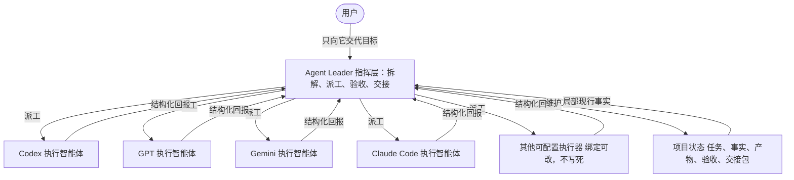
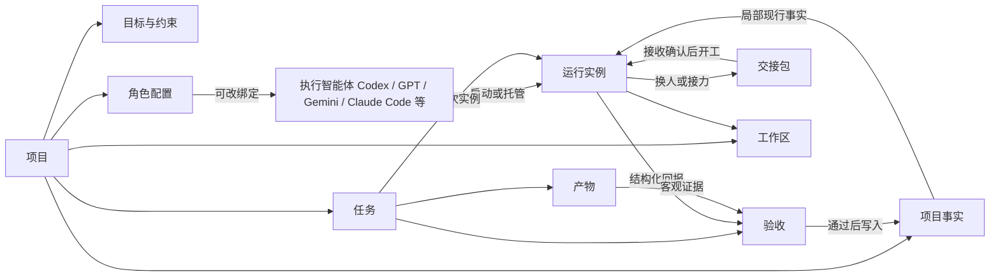
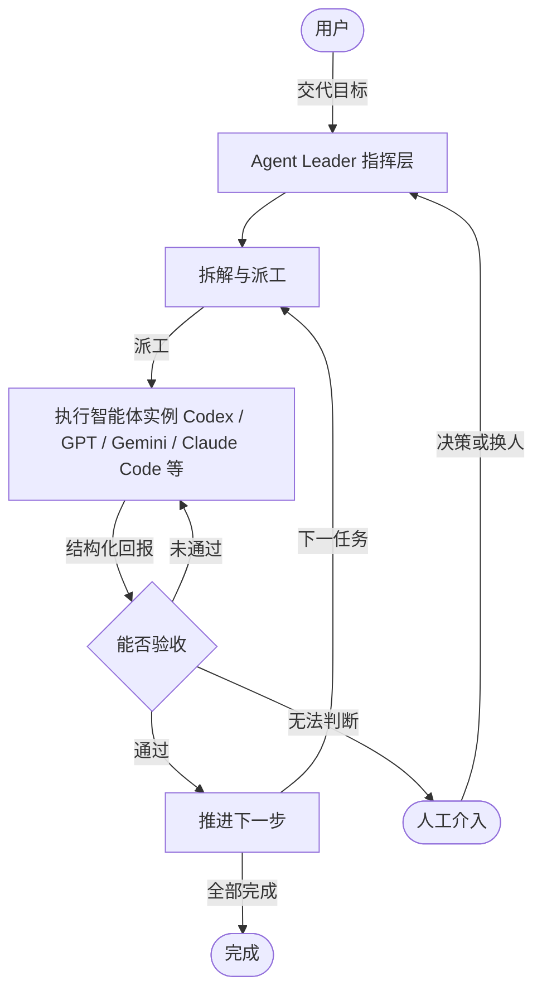
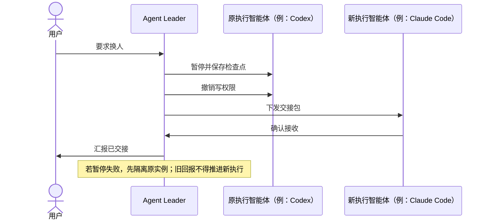
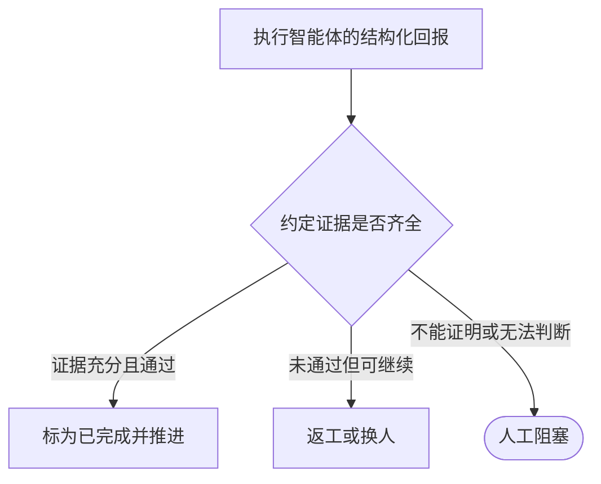
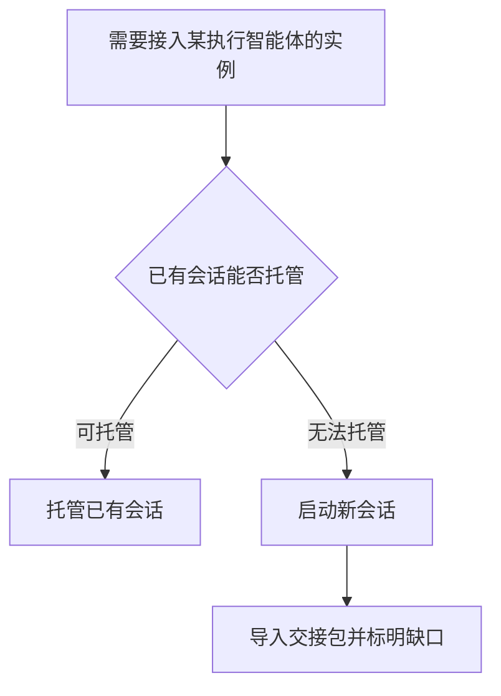
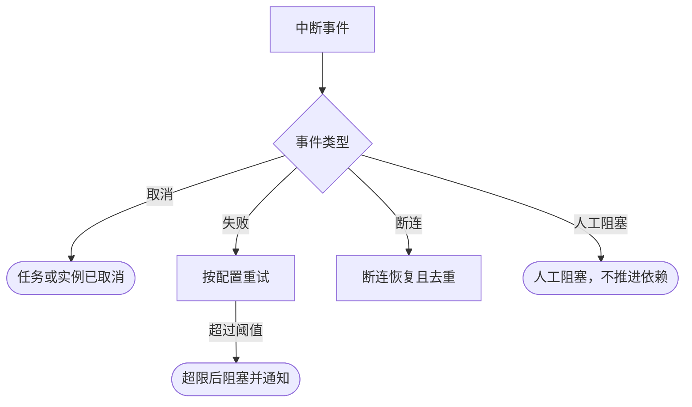
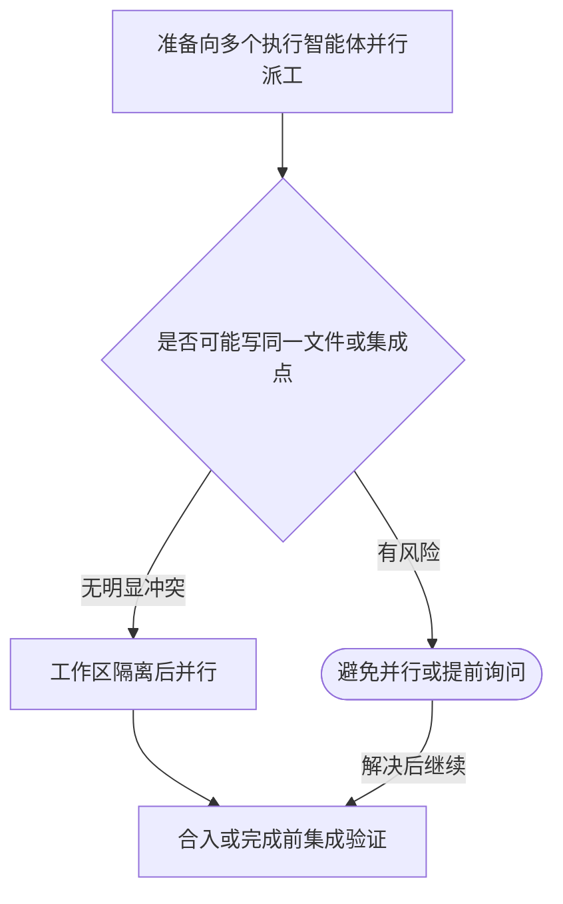
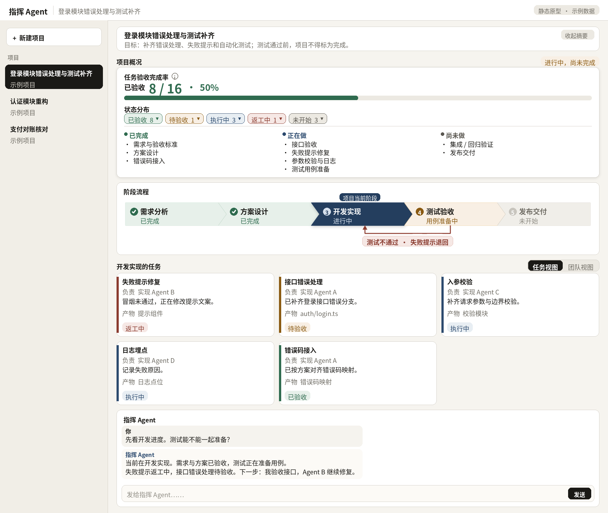

> 本文是 Cursor Page「Agent Leader 系统架构图 v0.2」的 Markdown 导出，便于离线阅读，未改写原文。原件见同目录 `source.canvas.tsx`。文中插图 `workbench-v08.png` 与界面样例 v0.8《工作台-精简文案》为同一张图。
>
> - Canvas：[Agent Leader 系统架构图 v0.2](https://cursor.com/canvas/store-677ff2fa-7a30-4969-b3db-3d9af3954dbf/1b1ba1eb-170c-4367-a933-8f103e6e09dd)
> - canvas_id：`1b1ba1eb-170c-4367-a933-8f103e6e09dd`
> - 页面更新：2026年11月24日 21:16（Asia/Shanghai）

---

# Agent Leader 系统架构图 v0.2

Agent Leader 是指挥层：负责拆解目标、派工、交接、验收与状态管理。Codex、GPT、Gemini、Claude Code 等是被指挥并真正干活的执行智能体。依据 PRD v0.1、交互设计方案 v0.1 与原型 v0.8，按用户定义的项目名称修订。

依据来源：
- https://cursor.com/canvas/store-677ff2fa-7a30-4969-b3db-3d9af3954dbf/c5339b29-2ec5-4fda-b7bd-4f3565921bfe
- https://cursor.com/canvas/store-677ff2fa-7a30-4969-b3db-3d9af3954dbf/7208c189-51de-46b9-840e-9c121593c281

## 目录

- [文档说明与范围](#intro)
- [指挥层与执行层](#context)
- [核心组件与责任](#components)
- [关键数据实体与状态](#data)
- [主要运行与协同流程](#flows)
- [工作面结构（原型 v0.8）](#workbench)
- [已决定事项、开放问题与假设](#open)

## 文档说明与范围 {#intro}

> **逻辑架构草案，不是已验证的集成或部署方案** 本页只整理已有需求与原型中出现的对象、职责与流程。文档未写的技术栈、服务、接口路径与运行时组件不写入本图。跨提供方调用、已有会话托管、运行中暂停与写权限回收等技术可行性尚未验证。

| 字段 | 值 |
| --- | --- |
| 项目名称 | Agent Leader |
| 架构版本 | v0.2 |
| 性质 | 逻辑架构草案 |
| 日期 | 2026年11月24日（Asia/Shanghai） |
| 依据 | PRD v0.1（待评审草案）、交互设计方案 v0.1、界面原型 v0.8；项目名称与指挥/执行关系按用户本轮定义修订 |

- [指挥 Agent 产品需求文档 PRD v0.1](https://cursor.com/canvas/store-677ff2fa-7a30-4969-b3db-3d9af3954dbf/c5339b29-2ec5-4fda-b7bd-4f3565921bfe) — Cursor Page · 2026-11-24 · 需求原文
- [指挥 Agent 交互设计方案 v0.1](https://cursor.com/canvas/store-677ff2fa-7a30-4969-b3db-3d9af3954dbf/7208c189-51de-46b9-840e-9c121593c281) — Cursor Page · 2026-11-24 · 交互方案

本页将 PRD 中的「指挥 Agent」作为产品角色，改称 Agent Leader（用户定义的项目名称）。需求原文仍归属 PRD，本页不改写那些文档。交互方案与界面原型仍使用原称谓。

## 指挥层与执行层 {#context}

Agent Leader 是面向个人开发者的单一交互入口，也是对其他智能体的指挥。用户只向它交代目标、补充约束或调整方向；由它拆成带依赖的任务，按可配置角色派给 Codex、GPT、Gemini、Claude Code 等执行智能体，再依据它们交回的结构化结果做客观验收。真正完成编码、规划与实现的是这些被指挥的执行智能体，不是 Agent Leader 自己。

**指挥关系（自上而下）**

#### 用户
只与 Agent Leader 交互，不需要进入 Codex、GPT、Gemini 或 Claude Code 的原生界面重复交代项目全貌。

↓ 下达目标、补充约束、查看进展、批准、换人与介入

#### Agent Leader · 指挥层
本产品是对执行智能体的指挥。它负责拆解、派工、回收结果、验收并安排交接，不亲自做编码、规划或实现。
- 理解目标
- 拆解任务
- 按角色派工
- 客观验收
- 维护事实
- 交接与换人

↓ 向下派工：下发局部上下文、现行事实与交接包 · 向上回收：已做工作、产物版本、验证证据、遗留问题 · 换人时由 Agent Leader 转交交接包

#### 执行层 · 被指挥，真正干活
具体编码、规划与实现由这些智能体完成。角色到执行器的绑定可随时改，不得写死某模型只能做某类工作。
- Codex
- GPT
- Gemini
- Claude Code
- 其他可配置执行器

| 层 | 谁 | 做什么 | 不做什么 |
| --- | --- | --- | --- |
| 指挥层 | Agent Leader | 拆解目标、按角色派工、回收结构化结果、客观验收、维护项目事实与状态、编排交接与换人。 | 不亲自完成编码、规划或实现，也不当成用户与各执行智能体分别对话的聚合窗口。 |
| 执行层 | Codex、GPT、Gemini、Claude Code，以及其他可配置执行器 | 接收任务与局部上下文，完成具体编码、规划或实现，交回产物、证据与遗留问题。 | 不作为用户的主交互入口；不共享全部聊天；角色绑定可改，不写死某模型只能做某类工作。 |

执行智能体位于产品外部。Agent Leader 向它们的运行实例下发与任务相关的局部上下文与现行事实，不共享全部聊天。密钥与凭据走独立秘密渠道，不随上下文下发，也不得写入项目事实或交接包正文。下图为更细的逻辑分层，不是进程或部署拓扑。

**系统分层（自上而下）**

#### 用户
先面向个人开发者自用为建议假设，尚待确认。用户只与 Agent Leader 交互，不必向各个执行智能体重复交代项目全貌。
- 下达目标与约束
- 查看进展
- 批准高风险操作
- 换人与介入

↓ 只向 Agent Leader 交代目标、批准、换人与介入

#### 指挥入口（Agent Leader 工作面）
产品形态（CLI、API、桌面或编辑器插件）待定。信息架构应保持稳定，不因形态缺失 FR-12 要求的信息。
- 目标与对话
- 任务与依赖
- 运行实例
- 项目事实与产物
- 验收与证据
- 待办与批准
- 交接与记录
- 配置

↓ 工作面只面向 Agent Leader，不替代执行智能体的原生界面

#### Agent Leader · 指挥层
用户的唯一交互对象，也是对执行智能体的指挥。它拆解目标、派工、回收结果、验收、维护事实并编排交接，不亲自完成编码、规划或实现。下列为逻辑职责，不代表已确定的模块边界。
- 理解目标
- 拆解与依赖调度
- 按角色派工
- 启动或尝试托管实例
- 客观验收
- 维护项目事实
- 交接与换人编排
- 人工阻塞与批准门控

↓ 向下派工：下发局部上下文、现行事实与交接包 · 向上回收结构化结果 · 换人时转交交接包

#### 执行层 · 被指挥的智能体
真正干活的是这些执行智能体：具体编码、规划、实现等工作由它们完成。下列名称是用户点名的可配置执行器，不是写死的唯一绑定。MVP 以两种执行器为接入验证目标，不承诺现有产品已可被 API 稳定控制。
- Codex
- GPT
- Gemini
- Claude Code
- 其他可配置执行器
- 角色配置与可改绑定
- 运行实例：启动新会话
- 运行实例：托管已有会话（可行性未验证）

↓ 向下调度 · 向上回报

#### 工具、工作区与秘密渠道
工作区与冲突处理按个人单项目并行开发设计，不按生产级分布式规格编写。秘密渠道的实现方式未定。
- 按角色配置的工具权限
- 高风险操作批准
- 工作区隔离与冲突提示
- 独立秘密渠道（密钥不得写入事实或交接包）

↓ 向下调度 · 向上回报

#### 项目状态与数据
接力依据是可追溯的项目事实，不等于聊天记录。产物须带真实版本标识，版本权威待确认。
- 任务
- 运行实例状态
- 项目事实
- 产物
- 验收与证据
- 交接包
- 检查点
- 换人记录

## 核心组件与责任 {#components}

下表按职责列出逻辑组件。名称用于对齐需求，不是已决定的实现边界。

| 逻辑组件 | 责任 | 依据 |
| --- | --- | --- |
| Agent Leader（指挥层） | 用户唯一交互对象。指挥 Codex、GPT、Gemini、Claude Code 等执行智能体：拆解目标、派工、回收结果、验收、维护状态并安排交接。不亲自完成编码、规划或实现。 | 产品定位；用户对本图的修订 |
| 执行智能体 | 被指挥并真正执行任务。用户点名的包括 Codex、GPT、Gemini、Claude Code；其他提供方也可配置。通过运行实例接收局部上下文，交回产物、证据与遗留问题。 | FR-03、FR-04、FR-05 |
| 指挥入口 | 让用户在不进入执行智能体原生界面的前提下，完成下达目标、查看进展、批准、换人与介入，并看到 FR-12 要求的全部信息。 | FR-01、FR-12 |
| 目标理解与任务拆解 | 将目标拆成带依赖、验收条件与角色归属的任务；未满足依赖的不得开工；任务可被取消。 | FR-02 |
| 角色与派工 | 按角色定义、默认绑定与硬约束，把任务派给 Codex、GPT、Gemini、Claude Code 等执行器。绑定可随时修改；硬约束优先于自动建议（自动建议属 P1）。 | FR-03、FR-14 |
| 实例接入 | 区分启动新会话与托管已有会话，两种模式都要展示能力边界。无法托管时只导入交接包并启动新会话，不假装已继承原会话。 | FR-04 |
| 验收裁决 | 事先约定验收条件。能用测试、文件或运行结果证明的，不得以另一模型的主观评价代替。缺少约定证据不得标完成。 | FR-05、FR-06 |
| 项目事实维护 | 维护条目、版本、来源与状态。聊天可作依据，但不自动成为事实。已废弃或失败方案不得混入现行事实下发。 | FR-07 |
| 交接与换人编排 | 换人、任务交接或无法托管时生成交接包。例如从 Codex 换到 Claude Code 时，先请求暂停、写入检查点并撤销写权限；暂停失败则隔离原实例。接收实例开工写作业前须确认交接包。 | FR-08、FR-09 |
| 调度与冲突提示 | 并行任务尽量工作区隔离。若可能改到相同文件或集成点，避免并行或先提示用户。合入或任务完成前需做集成验证。 | FR-10 |
| 状态与恢复 | 任务状态与运行实例状态分开记录，均可取消。实例结束不等于任务已验收。失败按配置重试且不无限重试；断连恢复须去重；人工阻塞时不得自动推进依赖后续任务。 | FR-11、FR-15 |
| 权限与批准门控 | 工具权限按角色配置。涉及敏感信息、破坏性命令、发布或对外提交的操作，须经用户批准后才可执行。默认批准策略待确认。 | FR-13、Q4 |

## 关键数据实体与状态 {#data}

实体定义以 PRD 核心概念为准。任务与运行实例必须分开记录；一个任务可对应多次运行实例，也可在不同执行智能体之间换人。

| 实体 | 定义 | 关键规则 |
| --- | --- | --- |
| Agent Leader | 用户唯一交互对象，也是对执行智能体的指挥。负责理解目标、拆解任务、派工、验收、维护项目状态并安排交接。 | 必须知道每项工作推进到哪里、依据是什么；不亲自完成编码、规划或实现。 |
| 执行智能体 | 被 Agent Leader 指挥、真正完成具体工作的外部智能体。用户点名的包括 Codex、GPT、Gemini、Claude Code。 | 是可配置的执行器候选，不是写死的唯一清单，也不预设某一家的能力边界。 |
| 提供方 / 模型 | 可接入的外部 Agent 或模型服务方，以及可绑定到角色的具体模型或工程。 | 产品不预设某一家的能力边界。 |
| 角色配置 | 用户可定义的职责，并绑定提供方、模型与工具权限。 | 规划与文档、实现、审查仅为示例，可改、可替换。例如可将规划绑到 Gemini、实现绑到 Codex，也可改绑到 Claude Code 或 GPT。 |
| 任务 | 带依赖、验收条件与角色归属的工作单元。 | 一个任务可对应多次运行实例；不能用实例已结束代替任务已验收。 |
| 运行实例 | 为执行某个任务而启动或尝试托管的一次具体执行，归属于某个执行智能体。 | 与任务是不同对象；写权限是否有效必须可被看到。 |
| 项目事实 | 共享且可追溯的项目事实集：条目、版本、来源与状态。 | 它是接力的依据，不等于聊天记录。 |
| 产物 | 任务产出的可核对对象，如文件、文档、测试结果。 | 必须带真实版本标识。版本权威（如 Git 提交或工作区快照）待确认。 |
| 验收 | 按事先约定的条件检查任务是否完成。 | 客观证据优先于模型意见，且须分开记录。 |
| 交接包 | 为接手的执行智能体准备的结构化上下文。 | 不等于导入对方的私有会话，不含密钥明文。 |
| 检查点 | 换人前写入的保存点。 | PRD 要求先写入检查点再撤销写权限；检查点的存储形式未写明。 |
| 工作区 | 并行任务尽量使用的独立工作区。 | 按个人单项目并行设计；隔离与冲突检测的可落地程度取决于最终形态与仓库工具链。 |

### 状态

| 对象 | PRD 状态（原文） |
| --- | --- |
| 任务 | 待拆解、待分配、待依赖、进行中、待验收、已完成、失败、已取消、人工阻塞 |
| 运行实例 | 待启动、启动中、运行中、暂停中、已暂停、已隔离、已完成、失败、断连、已取消 |
| 项目事实 | 已确认、待验证、已废弃、失败教训 |
| 验收结论 | 通过、未通过、尚未验收 |

已废弃与失败教训只可作为教训或避开项单独下发，不得混入现行事实。交接包字段以 PRD 为准：目标与成功标准、约束与硬性要求、已完成工作摘要、关键决策及依据、产物清单与真实版本、验收结果、未解决问题、已废弃或失败方案、建议下一步、接收者待确认项。建议下一步不得写成已确认事实。

## 主要运行与协同流程 {#flows}

主路径与分支规则来自 PRD 核心流程与 FR-01 至 FR-13。下方筛选只切换本页阅读视图。派工、回收结果与换人，都是 Agent Leader 对执行智能体的指挥关系。

页面筛选（仅改变阅读视图，不修改原文）：主路径 · 换人 · 无法验收 · 无法托管 · 失败恢复 · 并行冲突。以下导出列出全部内容。

### 主路径

1. **用户向 Agent Leader 下达目标**
   只向 Agent Leader 交代目标、补充约束或调整方向，不向各执行智能体重复交代全貌。
2. **Agent Leader 拆解为带依赖的任务**
   每个任务带验收条件与角色归属；未满足依赖的不得开工。
3. **按配置派工**
   依角色与默认绑定，把任务派给 Codex、GPT、Gemini、Claude Code 等执行智能体；绑定可改，用户硬约束优先。
4. **启动或尝试托管该执行智能体的实例**
   下发局部上下文与相关项目事实。若无法托管已有会话，则启动新会话并仅导入交接包。
5. **执行智能体交回结构化结果**
   交回已做工作、产物版本、验证证据、遗留问题与废弃尝试。这一步是真正干活的执行智能体完成的。
6. **Agent Leader 验收并决定是否推进**
   客观证据优先；不能证明则不标完成，进入返工、换人或人工阻塞。通过则推进依赖后续任务。

### 换人

目标是用户对 Agent Leader 说一句「换另一个执行智能体接着做」，无需再解释前面发生了什么。下图中的 Codex 与 Claude Code 仅为换人示例，实际可在任意已配置的执行智能体之间改绑。暂停与写权限回收的可靠度尚未验证；若做不到，首版必须退回到隔离并明确告知用户。

换人过程中不会有两个实例同时拥有有效写权限；隔离后的旧回报不改变新任务状态。

### 无法验收

缺少约定证据的任务，在状态与界面上均不得显示为已完成。人工阻塞时不得自动推进依赖后续任务。

### 无法托管

无法托管时须标明无法延续未导出上下文、私有记忆或隐藏思考。系统不假装已继承原会话。

### 失败恢复

达到用户设定的并发或重试上限后，系统不再启动新的自动执行并通知用户。预算阈值属 P1，计量方式待定。

### 并行冲突

本项按个人单项目并行开发设计，不按生产级分布式一致性规格实现。

## 工作面结构（原型 v0.8） {#workbench}

最新视觉以界面原型 v0.8《工作台-精简文案》为准。它把指挥入口编排成单页工作台，不改变 PRD 规定的八类信息区本身。FR-12 要求的信息仍须可在指挥入口中查看。该静态图仍标为「指挥 Agent」，尚未随项目名称改为 Agent Leader。

**工作台信息架构示意**

- **顶栏**：Agent Leader · 当前项目名称
- **左侧**：新建项目；项目名称列表
- **项目标题与目标**：当前目标与约束 · 可收起摘要
- **项目概况**：任务验收完成率 · 状态分布 · 已完成 / 正在做 / 尚未做
- **阶段流程**：需求分析 → 方案设计 → 开发实现 → 测试验收 → 发布交付；测试不通过可退回开发
- **当前阶段的任务**：任务卡（负责的执行智能体、产物、状态）· 任务视图 / 团队视图（本图展开任务视图）
- **与 Agent Leader 的对话**：全宽对话：用户指令、Agent Leader 回复与输入

*界面原型 v0.8《工作台-精简文案》（1920×1620，示例数据，非正式视觉定稿；图中产品名仍为「指挥 Agent」）*

| PRD 信息区 | 在 v0.8 主画面中的呈现 | 说明 |
| --- | --- | --- |
| 目标与对话 | 顶部目标文案与底部全宽对话 | 用户在此与 Agent Leader 对话，而不是直接操作各执行智能体。交互方案建议对话为唯一常驻入口；原型将它放在工作台底部。 |
| 任务与依赖 | 阶段流程与当前阶段任务卡 | 依赖在阶段回流与概况分列中部分体现；完整任务依赖图未作为独立主区。「阶段」是原型呈现分组，PRD 未将其列为核心概念。 |
| 运行实例 | 任务卡上的负责 Agent；团队视图入口已画出 | 本静态图展开的是任务视图，团队视图未展开。实例状态、写权限、暂停或隔离未在主画面单独列出。 |
| 项目事实与产物 | 任务卡上的产物字段 | 现行事实与已废弃/失败教训的分列未作为独立主区。 |
| 验收与证据 | 完成率、状态分布与任务卡状态 | 客观证据与模型意见的分区未作为独立主区。 |
| 待办与批准 | 本主画面未独立展开 | v0.1 线框中有待办与交接包画面。按 FR-12 仍需可达。 |
| 交接与记录 | 本主画面未独立展开 | 同上。 |
| 配置 | 本主画面未独立展开 | v0.2 起可从侧栏新建项目；角色、绑定、权限与阈值的配置面未在 v0.8 主画面出现。 |

### 原型与 PRD 状态对照

| 对象 | v0.8 展示 | 与 PRD 的关系 |
| --- | --- | --- |
| 任务 | 已验收、待验收、执行中、返工中、未开始 | 待验收与 PRD 直接对应；执行中近似进行中；已验收对应验收通过后的已完成。返工中、未开始为原型展示态，PRD 未单列；未开始可能覆盖待拆解、待分配或待依赖。失败、已取消、人工阻塞未在该图状态分布中出现。 |
| 运行实例 | 任务卡上的负责角色名 | PRD 中的实例十态与写权限是否有效，未在 v0.8 主画面单独展示。 |
| 项目完成 | 任务验收完成率按计划任务数计；待验收与返工不计入完成 | 与「单项完成不等于项目完成」一致。统计口径以信息入口 i 标出，本图未展开。 |

### 原型信息架构演进

| 版本 | 工作面结构 |
| --- | --- |
| v0.1 | 左侧按 PRD 八个信息区导航；主画面为目标与对话，侧栏露出任务、实例、事实、验收与待办；交接包为独立画面。 |
| v0.2 | 左侧改为项目列表与新建项目（背景与目标两个主输入）。工作台以团队 Agent 卡片为主，中部对话，右下项目汇总。点击卡片打开 Agent 详情。用户不必逐个指派。 |
| v0.3–v0.5 | 引入阶段流程；点选阶段切换任务。v0.4 起使用咬合式阶段条，并在测试验收与开发实现之间补回流。 |
| v0.6 | 顶部改为全局项目概况，不随点选阶段改变；取消右下汇总，底部为全宽指挥对话。 |
| v0.7 | 概况改为全项目量化：任务验收完成率与五种互斥状态计数。 |
| v0.8（最新） | 继承 v0.7 布局并精简教学与重复文案；统计口径收为信息入口；指挥区只保留标题、对话与输入。 |

## 已决定事项、开放问题与假设 {#open}

### 已确认需求（来自 PRD）

- 用户只通过单一入口与 Agent Leader 交互。
- 将目标拆解为带依赖的步骤，并按配置分给不同提供方和多个实例。
- 分工必须可定义、可定制，不能固化某模型的能力。
- 收到结果后要自行验收再推进；判断不了则请人介入。
- 可随时让另一执行器接手，并交接目标、上下文与文件等。
- 同一提供方的多实例并行时，也要能协作与交接。

### PRD 建议假设（尚非已定需求）

- 先面向个人开发者自用，而不是团队产品。
- 先做单项目、多工作区，以同仓库协作为主场景。
- 产品形态（CLI、API、桌面或编辑器插件）待定。
- MVP 采用默认绑定策略，换人以手动为主。
- MVP 以两种执行器作为接入验证目标，不承诺现有产品已可 API 控制。

### 待确认问题

| 编号 | 问题 | 对架构的影响 |
| --- | --- | --- |
| Q1 | 首版是否确认采用「个人自用 + 单项目多工作区」，以及是否以同仓库协作为主场景？ | 决定项目边界与是否出现跨项目引用。原型侧栏已出现多项目列表，与此问题尚未对齐。跨项目调度属后续（FR-16）。 |
| Q2 | 产品形态优先做成 CLI、API、桌面应用还是编辑器插件？ | 决定工作面的具体表现与接入方式，不改变信息架构与指挥/执行分层。本图不预设形态。 |
| Q3 | MVP 验证的两种执行器，各自可接受的接入方式是什么？若暂时只能启动新会话、不能托管已有会话，是否接受以此发布首版？ | 决定接入层能力边界。Codex、GPT、Gemini、Claude Code 是可配置候选，不等于已验证的接入清单，也未指定 MVP 先验证哪两种。 |
| Q4 | 高风险操作（安装依赖、推送、发布、删除）的默认批准策略是什么？ | 决定批准门控的默认语气与阻断点。本图只保留「未批准不执行」，不预设默认允许或默认拒绝。 |
| Q5 | 项目事实中「真实版本」以什么为权威：Git 提交、工作区快照，还是其他机制？ | 决定产物与交接包中的版本标识如何落地。本图只要求可核对标识，不预设机制。 |
| 交互补充 | 角色绑定中途修改后，进行中实例是否保持原绑定直至结束？ | PRD 未写明。影响改绑后的调度与实例生命周期，不在本图中冒充。 |

### 本图的架构推断（已标明为假设）

- 产品名称 Agent Leader 为用户在本轮定义；PRD 与原型仍使用「指挥 Agent」称谓，本页不回写那些文档。
- Codex、GPT、Gemini、Claude Code 是用户点名的执行智能体，作为可配置提供方画出，不是写死的角色绑定，也不构成已验证的接入清单。MVP 仍以两种执行器为接入验证目标。
- 本图将「指挥层 vs 执行层」作为主结构：Agent Leader 负责指挥，不亲自完成编码、规划或实现。这一点对齐用户对本图的修订意见，并与 PRD 「不一定亲自写代码」的定位一致。
- 本图是逻辑分层与责任视图，不是部署图，也不是技术栈选型。
- Agent Leader 内部能力按职责划为逻辑组件，不代表已确定的服务拆分或接口边界。
- 接入层被画出，仅因为 PRD 要求区分新会话与托管已有会话；接入协议、控制接口与托管能力均未验证。
- 原型中的「阶段流程」视为工作面呈现分组，不上升为 PRD 核心域概念，除非后续需求确认。
- 原型侧栏出现多个项目，架构上仍把项目作为边界对象；是否首版就支持多项目切换，取决于 Q1。
- 秘密渠道被画出，仅因为 PRD 要求凭据不随上下文下发；具体机制未定。

以下技术点的可行性尚未验证，不得当成已有能力：目标执行器是否提供稳定可程序化的控制接口；已有会话是否可被托管；运行中实例是否可被可靠暂停并撤销写权限；交接包能否在不导入私有会话的前提下完成等价接力；工作区隔离与冲突检测的可落地程度取决于最终形态与仓库工具链。

*— 回到顶部 —*
