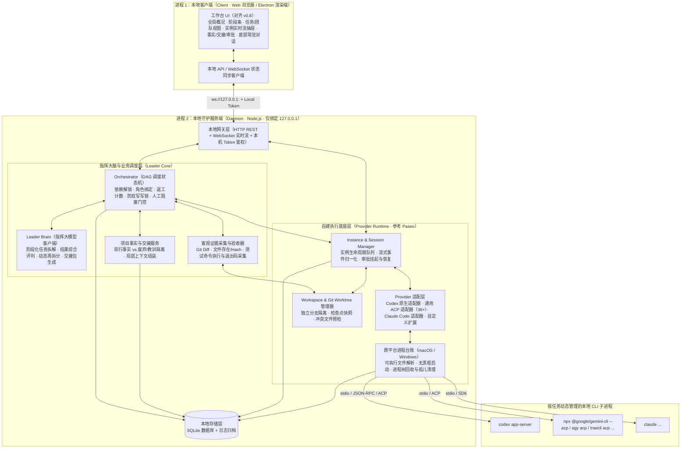

# Agent Leader 系统技术架构与实施规划（v0.3）

> **版本状态**：工程架构基线版（指导后续代码重构与开发）
> **对应需求**：[Agent Leader 产品需求文档 PRD v0.2](../01-产品需求文档-PRD-v0.2/Agent-Leader-产品需求文档-PRD-v0.2.md)
> **底层运行时专项规范**：[多 Agent 统一控制与数据回传系统架构方案](../multi_agent_control_and_data_return_plan.md)（直接作为 `daemon/runtime` 层的接口与状态机实现契约）
> **历史参考**：[Agent Leader 系统架构图 v0.2（逻辑草案）](../03-系统架构图-v0.2/Agent-Leader-系统架构图-v0.2.md)
> **更新日期**：2026年11月25日（Asia/Shanghai）
> **目标运行平台**：macOS、Windows（纯本地 C/S 双进程）

---

## 目录

- [1. 架构目标与核心取舍](#1-架构目标与核心取舍)
- [2. 运行态双进程模型与总体分层](#2-运行态双进程模型与总体分层)
- [3. 单仓 Monorepo 目录结构规划](#3-单仓-monorepo-目录结构规划)
- [4. 后台指挥大模型（Leader Brain）与调度引擎设计](#4-后台指挥大模型leader-brain与调度引擎设计)
- [5. 自建执行底座（Provider Runtime）详细设计](#5-自建执行底座provider-runtime详细设计)
- [6. 工作区隔离、客观证据采集与安全换人机制](#6-工作区隔离客观证据采集与安全换人机制)
- [7. macOS 与 Windows 双平台兼容方案](#7-macos-与-windows-双平台兼容方案)
- [8. 本地存储与前后端通信协议](#8-本地存储与前后端通信协议)
- [9. 分阶段实施路线图（Roadmap）](#9-分阶段实施路线图roadmap)

---

## 1. 架构目标与核心取舍

本架构围绕「**后台指挥大模型驱动软件工程拆解与验收决策 + 参考 Paseo 自建本地多执行智能体调度底座**」构建，明确以下工程原则：

| 维度 | 架构选型 | 取舍理由（对比 Paseo 原工程） |
| --- | --- | --- |
| **进程模型** | **本地 C/S 双进程**（`Daemon` 后台守护进程 + `Client` 界面进程）+ 按需拉起的执行器 CLI 子进程 | 保留 Paseo 将 Agent 生命周期托管在独立 Daemon 的核心优势，防止刷新/关闭 UI 杀死正在写代码的智能体；同时把跨平台进程管理与写权限锁统一收口在服务端。 |
| **网络范围** | **仅限本机 `127.0.0.1`**（HTTP + WebSocket） | **主动砍掉** Paseo 的公网 Relay、E2EE Noise 隧道、远程配对、Expo 移动端与多主机路由，复杂度直降 60%，聚焦本机极速稳定体验。 |
| **代码组织** | **单仓 Monorepo**（npm / pnpm workspaces） | 前后端共享同一份 `protocol` 类型与校验契约，杜绝双仓联调时的字段漂移。 |
| **指挥层实现** | **Daemon 内置 `Leader Brain` + `DAG Orchestrator`** | 在 Paseo 偏“工作区会话管理”的底座之上，构建原生的「阶段拆解 → 局部事实派工 → 过程监控 → 结合回复与客观证据评判 / 返工 / 动态再拆分」自治闭环。 |
| **桌面跨平台** | 开发期 `Daemon + Web`，发布期封装 **Electron**（macOS `.dmg` / Windows `.exe`） | 全栈统一 TypeScript / Node.js，无需维护两套异构语言运行时；Electron 主进程天然支持托管本地 Node Daemon 与系统托盘常驻。 |

---

## 2. 运行态双进程模型与总体分层

### 2.1 运行态拓扑图



---

## 3. 单仓 Monorepo 目录结构规划

后续进入编码阶段时，将现有根目录原型平滑演进为如下 Workspace 结构：

```text
agent-leader/
  package.json                    # Workspace 根配置与统一构建/检查脚本
  tsconfig.base.json              # 共享 TS 编译基线
  docs/                           # 产品需求、架构与界面文档
  packages/
    protocol/                     # 【共享契约包】前后端唯一的协议与类型来源
      src/
        entities.ts               # Project, Task, Instance, Fact, Artifact, Handoff, Approval 等模型
        providers.ts              # 48 款 Provider 清单元数据、能力标记与自定义配置 Schema
        ws-events.ts              # WebSocket 实时推送事件与客户端指令 Schema（Zod）
        brain-schemas.ts          # 指挥大模型输出的结构化 JSON Schema
    daemon/                       # 【本地守护服务端】核心指挥逻辑与执行底座
      src/
        server/                   # 127.0.0.1 HTTP + WebSocket 服务与本地鉴权
        brain/                    # 指挥大模型适配（OpenAI 兼容 / Anthropic / Gemini）与三大决策 Prompt
        orchestrator/             # 任务 DAG 调度器、状态机、动态拆解合并器、换人防双写编排
        facts/                    # 项目事实库、敏感词脱敏、局部上下文与交接包构建器
        acceptance/               # 客观证据采集器（Git 状态/Diff、产物校验、验证命令运行）
        workspace/                # Git Worktree 创建、检查点快照、同文件冲突扫描与清理
        runtime/                  # 参考 Paseo 自建的执行底座（对齐 multi_agent_control_and_data_return_plan.md）
          contracts/              # AgentClient, AgentSession, AgentStreamEvent, AgentTimelineItem
          control/                # AgentManager, AgentMessageDelivery(queue/steer/interrupt/hold), IdleRuntimeCleanup, ProcessSupervisor
          return-channels/        # StreamCoalescer, TimelineProjection(epoch/seq/裁剪), FinishSubscriptions, ActivityCurator, StructuredResponse
          providers/              # 五类异构驱动模式实现与 48 款注册表
            codex/                # 专用 AppServer JSON-RPC 适配器（MVP 首选）
            acp/                  # 通用 ACP stdio JSON-RPC 基类 + 36 款目录预设 + 内置 ACP 扩展
            claude/               # SDK / 流式子进程适配器
            opencode/             # HTTP/SSE + 本地回环桥适配器（P1）
            jsonl-rpc/            # Pi / OMP JSONL Stdio RPC 适配器（P1）
        storage/                  # SQLite 持久化层（数据库表与 DAO）
    web/                          # 【本地工作台前端】由现有 src/ 迁移演进
      src/
        components/               # v0.8 工作台、阶段条、任务/团队卡片、实例流式日志抽屉、配置中心
        client/                   # Daemon HTTP/WS 连接器、断线自动重连与本地状态同步 Store
    desktop/                      # 【P1 桌面壳】Electron 跨平台封装（macOS & Windows）
      src/
        main.ts                   # 自动探测/拉起 Daemon、注入本机 Token、系统托盘、退出守护策略
```

---

## 4. 后台指挥大模型（Leader Brain）与调度引擎设计

### 4.1 指挥大模型接入抽象（`BrainClient`）

为避免绑定单一厂商，封装统一的 `BrainClient` 接口，要求底层支持 `Structured Outputs / JSON Schema`：
- **OpenAI Compatible Adapter**：覆盖 OpenAI 官方、DeepSeek、OpenRouter、本地 vLLM/Ollama 及各类兼容网关；
- **Anthropic Adapter**：覆盖 Claude 系列模型（通过 Tool Use 强制结构化输出）；
- **Gemini Adapter**：覆盖 Google Gemini 系列模型（通过 `responseSchema` 强制结构化输出）。

### 4.2 三大核心决策器契约

#### 1）`TaskPlanner`（初始阶段化任务拆解）
- **触发时机**：用户新建项目并提交「项目背景 + 目标」，或在对话中下达全新阶段目标。
- **输入上下文**：项目背景、目标文本、硬性约束、本地仓库顶层目录树与 `package.json`/`README` 摘要、当前已配置角色列表。
- **结构化输出 Schema**：
  - `projectSummary`：目标与核心约束提炼；
  - `tasks[]`：按软件开发阶段（`需求分析` | `方案设计` | `开发实现` | `测试验收` | `发布交付`）组织的任务数组，每项含 `tempId`、`stage`、`title`、`roleId`、`deps[]`、`instruction`、`expectedArtifacts[]`、`acceptanceCriteria[]`、`verificationCommands[]`、`targetPaths[]`（用于并行冲突预判）。

#### 2）`ContextAssembler`（局部上下文与防污染派工包组装）
- **确定性组装（不依赖聊天全集）**：每次派发某个子任务给执行器（如 Codex）时，按固定模板拼装提示词：
  1. **任务目标与成功验收标准**；
  2. **项目硬约束与角色边界**；
  3. **关联的已确认现行事实**（仅筛选 `status = confirmed` 且与当前任务相关的条目）；
  4. **上游依赖任务的真实产物路径与版本号**；
  5. **避坑警示区**（单独列出本任务或前序任务记录的 `deprecated` / `lesson` 失败尝试，明确告知“请勿重复以下路径”）；
  6. **结构化结项汇报要求**（要求执行器结束时输出已完成事项、修改文件、自行运行的验证结果与遗留风险）。

#### 3）`TurnEvaluator`（结果综合评判与动态再决策）
- **触发时机**：执行器（如 Codex）完成当前轮次汇报后，先由 `AcceptSvc` 自动采集客观证据，再一并送入指挥大模型评判。
- **双源输入（防忽悠机制）**：
  - **主观汇报源**：执行器最后一轮的完整回复文本、工具调用摘要、执行器自述遗留问题；
  - **客观证据源**：Daemon 在对应工作区实测采集的 `git status`、`git diff --stat` 及关键变更摘要、预期产物文件是否存在及 Hash、自动或执行器已跑过的验证命令退出码（Exit Code）与尾部日志。
- **五选一结构化决策输出**：
  ```ts
  type BrainEvaluationDecision =
    | {
        action: "ACCEPT";
        summary: string;
        confirmedFactsToSave: Array<{ content: string; version: string }>;
      }
    | {
        action: "REWORK";
        reason: string;
        reworkInstruction: string;
        lessonToRecord?: string;
      }
    | {
        action: "SPLIT_TASKS";
        reason: string;
        newTasks: PlannedTaskSpec[]; // 动态新增/细化的子任务
        rewireDownstreamDeps?: Array<{ taskId: string; addDepTempIds: string[] }>;
      }
    | {
        action: "SUGGEST_SWITCH";
        reason: string;
        recommendedRoleOrProvider?: string;
      }
    | {
        action: "BLOCK_FOR_HUMAN";
        reason: string;
        questionForUser: string;
        options?: string[];
      };
  ```

### 4.3 动态二次拆分子任务（`SPLIT_TASKS`）的安全护栏

为防止指挥大模型无限递归拆任务导致死循环，调度器内置三条硬护栏：
1. **DAG 无环校验（Cycle Detection）**：新子任务织入任务图前必须通过拓扑排序校验，若产生环路则拒绝合并并降级为人工确认；
2. **最大拆解深度与总数阈值**：单条链路动态派生深度默认不超过 `3` 层，单次新增子任务不超过 `8` 个，超出阈值时暂停自动拆解并请用户在对话区确认；
3. **完成率透明重算**：动态新增子任务入库后，顶栏全局进度（`已验收 / 计划总任务数`）实时平滑更新，并在时间线留存「因发现 XX 问题动态补充 N 项子任务」的审计记录。

---

## 5. 自建执行底座（Provider Runtime）详细设计

`daemon/src/runtime/` 模块严格遵循专项规范 **[《多 Agent 统一控制与数据回传系统架构方案》](../multi_agent_control_and_data_return_plan.md)** 进行建设（唯一裁剪项：砍掉该规范 2.6 节中的跨机器 `serverId` 远端路由，全部限定在本机 `127.0.0.1` 执行）。

### 5.1 核心接口与控制流水线对齐

直接采用专项规范定义的双契约与四层数据回传底座：
1. **统一抽象契约（`AgentClient` & `AgentSession`）**：屏蔽底层协议差异，统一暴露 `createSession` / `resumeSession`、`startTurn`、`steerActiveTurn`（带 `expectedTurnId` 校验）、`interrupt`（未确认停止前严禁开启新 Turn 防脑裂）、`respondToPermission`、`canStopRuntime`（空闲回收安全否决）与 `describePersistence`。
2. **逻辑记录与进程按需驻留解耦（Runtime Residency）**：支持 `closed` 态按需热恢复（`ensureAgentLoaded`）与 1 小时空闲进程自动回收（含未决权限、排队消息、活跃后台任务否决保护）。
3. **单接收方严格保序消息调度（`AgentMessageDelivery`）**：统一收敛 `queue`（2s/10s 合并窗）、`steer`、`interrupt` 与 `Stop` 挂起（`held`）；高优消息将队列前缀消息按序打包在前面一并送入，绝不插队乱序。
4. **流事件归一化与四路回传通道**：
   - **归一化底座**：`AgentStreamCoalescer` 短窗节流 ➔ 单条 **64 KiB（工具）/ 256 KiB（消息）** 容量裁剪防爆内存 ➔ `TimelineProjection` 分配单调 `(epoch, seq)` 并记录 `sourceSeqRanges` 原地折叠；
   - **面向指挥层（Leader Brain / Orchestrator）**：复用 `FinishSubscriptions`（派发前先落盘订阅，保证 At-Least-Once 唤醒；权限请求作为 Checkpoint 不销毁订阅；完成通知截断至 4000 字符并做 XML 实体转义防注入）+ 按需调用 `ActivityCurator` 拉取高信噪比浓缩轨迹；
   - **面向工作台 UI**：采用「`agent_stream` 实时低延迟增量轨 + `fetch_agent_timeline` 游标分页权威轨」，前端利用 `sourceSeqRanges` 原地替换半截流式消息，断线重连零丢失、零重复；
   - **面向结构化提取**：内置括号深度提取 + Zod/JSON Schema 校验纠错重试（`StructuredResponse`），同时服务于内部工具调用与指挥大模型的结构化决策容错。
5. **严格落实十条防坑铁律（Invariants）**：包括派发前先落盘完成订阅、Run Token 隔离迟到事件、Session 级取消加 `stopping` 门控、终态前结清所有临时加载卡片、读取 `closed` 实例结果不唤醒子进程等（详见专项规范 5.3 节）。

### 5.2 三类核心适配器实现策略

1. **Codex 原生适配器（MVP 第一优先级）**
   - **通信机制**：通过子进程拉起本机 `codex app-server`（基于 stdio JSONL RPC 通信），避免抓取粗糙的终端 ANSI 字符流。
   - **过程掌控**：订阅 `thread` 与 `turn` 生命周期事件，将模型回复增量、命令执行、文件补丁（Patch）与审批请求实时映射为标准 `AgentStreamEvent` 与 `AgentTimelineItem`。
   - **权限与写门控**：未授予写权限（如待确认交接包阶段）时以只读沙箱策略启动；高风险命令（删除、网络装包、`git push`）通过 `on-request` 审批钩子拦截并推送到 Agent Leader 待办面板。
   - **转向与中断**：原生调用 `turn/steer`（运行中微调）与 `turn/interrupt`（换人或取消时立即终止当前轮次并清空待处理输入）。

2. **通用 ACP（Agent Client Protocol）适配器（解锁 36+ 款目录智能体 + 内置 ACP 扩展）**
   - **通信机制**：通过 stdio JSON-RPC 2.0 启动目标 CLI（如 `agy acp`、`npx -y @google/gemini-cli --acp`、`cursor-agent acp`、`traecli acp serve`、`npx -y @qwen-code/qwen-code --acp` 等）。
   - **标准握手与执行**：发送 `initialize` 获取智能体支持的模式与模型清单 → `session/new` 绑定工作区目录 `cwd` → `session/prompt` 流式接收 `session/update` 消息块与工具调用 → 拦截 `session/request_permission` 桥接至工作台审批 → 换人或取消时调用 `session/cancel`。
   - **内置目录注册表**：在 `@agent-leader/protocol` 中维护 PRD 第 6 章定义的全部 **48 款 Provider 元数据注册表**（含默认启动命令、安装指引链接、环境变量模板与图标）。

3. **Claude Code 原生适配器**
   - 通过本机 `claude` CLI 的 `--output-format stream-json --input-format stream-json` 流式双向协议（及权限回调机制）驱动，支持会话 `--resume` 恢复、多档权限模式映射与精准中断。

---

## 6. 工作区隔离、客观证据采集与安全换人机制

### 6.1 Git Worktree 工作区隔离

- **隔离策略**：
  - 单任务串行或纯文档/分析任务：可直接使用项目主目录（或只读模式）；
  - 多实例并行编码任务：由 `WorktreeMgr` 自动在项目受管目录（如 `~/.agent-leader/worktrees/<projectId>/<taskId>`）执行 `git worktree add -b al/<taskId> <path> <baseRef>`，让每个执行器在独立目录和独立分支写代码，彻底杜绝并行改坏同一份工作树。
- **冲突预检**：派工前比对并行任务的 `targetPaths[]`，若存在重叠文件或公共入口文件，调度器自动改为先后串行，或在工作台提示用户确认。

### 6.2 客观证据采集器（`AcceptSvc`）

每当执行器结束一轮执行时，Daemon 在其工作区自动执行以下只读核验动作：
1. 运行 `git status --porcelain` 与 `git diff --stat`，核实实际改动文件列表并计算快照标识；
2. 校验任务约定的 `expectedArtifacts` 文件是否真实存在且非空；
3. 若任务配置了自动验证命令（如 `npm run build`、`npm test`、类型检查等，在安全白名单内），在工作区执行并捕获真实 `exitCode` 与输出摘要；
4. 将上述不可伪造的客观证据打包连同执行器回复交给 `Leader Brain` 做最终验收裁决。

### 6.3 安全换人与防双写状态锁

在 `Orchestrator` 中为每个 `taskId / workspaceId` 维护唯一**写令牌（`activeWriterInstanceId`）**：
1. 发起换人时，立即将 `activeWriterInstanceId` 置空（先锁门）；
2. 调用原实例 `interruptTurn()`，并在工作区生成 Git 检查点（如临时保存 commit 或 stash 快照）；
3. 若原实例在超时窗口（如 `5s`）内未停稳，直接由 `ProcessSupervisor` 强制杀死其进程树，并将该实例标记为 `isolated`（已隔离）；任何来自非当前 `activeWriterInstanceId` 的事件或回报在入口处直接丢弃；
4. 由 `Leader Brain` 结合最新事实库、检查点 Diff 与未决问题生成 10 字段**标准交接包**；
5. 新实例以只读/受限态启动并读取交接包，返回确认回执后，系统才将 `activeWriterInstanceId` 赋给新实例并放开写权限。

---

## 7. macOS 与 Windows 双平台兼容方案

由于所有 CLI 子进程均在用户本地运行，必须从架构底层抹平 **macOS（POSIX）** 与 **Windows（Win32）** 差异：

| 跨平台痛点 | 统一工程方案 |
| --- | --- |
| **CLI 可执行文件查找与启动** | Windows 下 `npm`/`npx`/`codex`/`claude` 常为 `.cmd` 或 `.ps1` 包装脚本，直接 `child_process.spawn("npx", ...)` 会报 `ENOENT`。`ProcessSupervisor` 内置跨平台命令解析器（借助 `which` / `PATHEXT` 定位真实入口，必要时安全解析 `.cmd` 对应的 Node 脚本或按规范包裹参数），严禁裸拼未转义的 shell 字符串。 |
| **Windows 控制台黑框闪烁** | 所有 `spawn` 调用统一强制设置 `windowsHide: true`，保证后台拉起多个智能体与 Git 命令时桌面零弹窗干扰。 |
| **彻底杀死子进程树（防僵尸进程）** | AI CLI 常会再拉起编译器、测试进程或 MCP 子进程：<br>• **macOS**：以 `detached: true` 创建独立进程组，终止时向负 PID（`-pid`）发送 `SIGTERM` → 超时补 `SIGKILL`；<br>• **Windows**：调用 `taskkill /PID <pid> /T /F` 递归清理整棵子进程树。 |
| **Daemon 崩溃后的孤儿进程回收** | 每次 `spawn` 成功后立即将 `{ pid, createTime, command, instanceId }` 写入本地 SQLite `managed_processes` 台账；Daemon 每次启动自检台账，核对进程创建时间/命令行指纹一致后自动清理上次异常残留的孤儿进程。 |
| **文件路径与编码规范** | 存储与协议层统一使用正斜杠相对路径展示，底层磁盘操作统一经 `node:path` 解析；子进程管道强制 UTF-8（Windows 注入 `PYTHONUTF8=1`、`LANG=C.UTF-8` 等环境变量防止中文乱码）。 |
| **本机安全与凭据存储** | Daemon 仅监听 `127.0.0.1`；启动时在用户目录（macOS `~/.agent-leader/`，Windows `%APPDATA%\AgentLeader\`）写入权限受限的 `daemon.lock`（含端口与一次性随机 Token）；API Key 优先使用 Electron `safeStorage` / 系统钥匙串加密保存。 |

---

## 8. 本地存储与前后端通信协议

### 8.1 本地持久化（SQLite）

采用单文件本地 **SQLite**（开启 WAL 模式，读写并发快、事务原子性强，彻底避免多任务并发写 JSON 文件损坏）：
- 核心表：`projects`、`workspaces`、`roles`、`provider_configs`、`tasks`、`task_dependencies`、`instances`、`timeline_events`、`facts`、`artifacts`、`handoff_packages`、`approvals`、`chat_messages`、`managed_processes`。

### 8.2 本地 C/S 通信契约（HTTP + WebSocket）

- **HTTP REST（命令与查询）**：新建/切换项目、读取历史快照、更新指挥大模型配置与 48 款 Provider 配置、提交审批决策、手动触发换人。
- **WebSocket（单连接全双工实时流）**：
  - 连接建立后推送当前激活项目的完整状态快照（`project.snapshot`）；
  - 运行期间增量推送：`task.updated`、`dag.split_applied`、`instance.event`（流式文本/工具调用/文件改动）、`brain.thinking` / `brain.decision`、`approval.created`、`handoff.updated`、`chat.message`；
  - 每个增量事件携带单调递增 `seq` 序号，前端断线重连后传入 `lastSeq` 即可无缝补齐漏掉的事件流。

---

## 9. 分阶段实施路线图（Roadmap）

> 当前阶段先冻结本需求与架构基线；进入代码实施后按以下 6 个里程碑渐进交付，每一步均保持系统可运行、可验证：

| 阶段 | 里程碑名称 | 核心建设内容 | 里程碑验收标志 |
| --- | --- | --- | --- |
| **Phase 1** | **Monorepo 骨架与本地 C/S 底座** | 拆分 `protocol` / `daemon` / `web` 包；搭建 `127.0.0.1` HTTP+WS 服务与 SQLite 存储；将现有 Web 原型从纯内存 Mock 切换为连接本地 Daemon 读写项目数据。 | 前后端双进程跑通，刷新浏览器状态持久化不丢失。 |
| **Phase 2** | **指挥大模型（Leader Brain）与阶段拆解调度** | 实现 `BrainClient`（OpenAI 兼容 / Anthropic / Gemini）；打通「新建项目 → 按软件工程阶段拆解 DAG 子任务 → 底部常驻指挥对话」闭环。 | 输入真实项目目标后，指挥大模型生成完整阶段任务卡片与依赖图。 |
| **Phase 3** | **Codex 原生接入、实时监控与评判再拆分闭环** | 实现跨平台 `ProcessSupervisor`、`WorktreeMgr` 与 **Codex 原生适配器**；打通派工执行、实时流式时间线、客观证据采集，以及指挥大模型的 `通过 / 返工 / 动态再拆分子任务` 自治循环。 | **核心 MVP 跑通**：Agent Leader 真实指挥本机 Codex 完成多步开发与测试验收闭环。 |
| **Phase 4** | **安全换人、标准交接包与高风险审批** | 实现防双写写令牌锁、检查点快照、进程强制隔离、10 字段交接包生成与接收确认门控、高风险操作挂起审批及项目事实库防污染下发。 | Codex 执行中途一键换另一实例/执行器接手，零重复解释且无双写冲突。 |
| **Phase 5** | **通用 ACP 适配器、Claude Code 与 48 款智能体目录** | 实现标准 stdio `ACPAgentClient` 与 `Claude Code` 原生适配器；内置完整 **48 款智能体目录**、本机安装检测与自定义 Provider 配置面板。 | 可在 Codex、Claude Code、Antigravity、Gemini CLI、Cursor、TRAE、Qwen Code 等多智能体间自由混编分工。 |
| **Phase 6** | **Electron 桌面端封装与 macOS / Windows 双端交付** | 新增 `packages/desktop`，实现打开应用自动托管 Daemon、系统托盘后台常驻、凭据加密存储，完成 macOS 与 Windows 安装包构建与双平台兼容性回归验证。 | 产出可双击安装的 macOS `.dmg` 与 Windows `.exe` 客户端。 |
