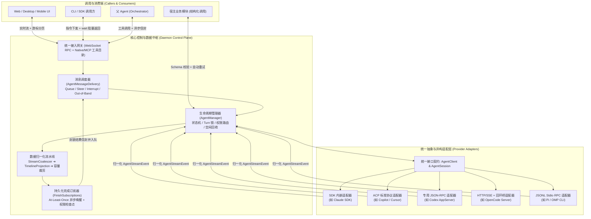
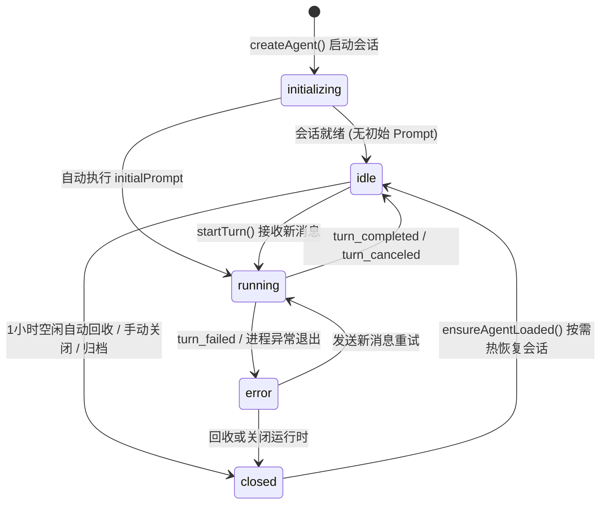
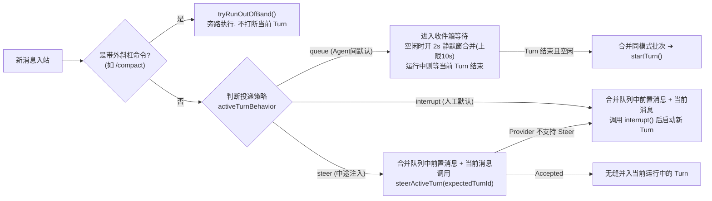
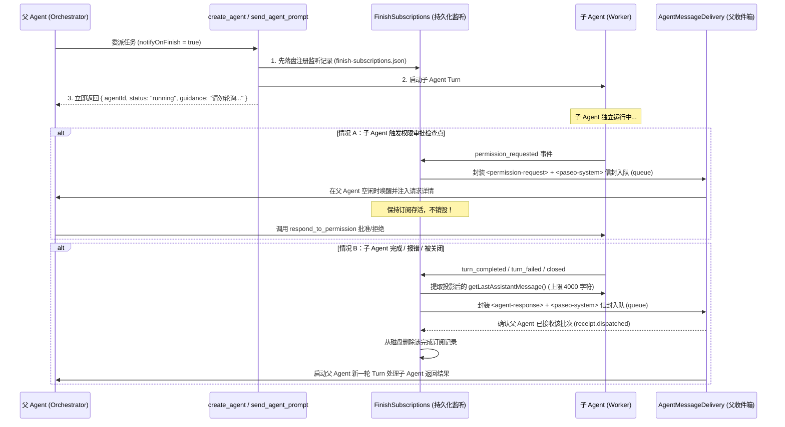

# 多 Agent 统一控制与数据回传系统架构方案

> [!IMPORTANT]
> **使用说明**：本方案基于 Paseo 最新核心架构提炼而成，剥离了特定 UI 细节，保留了完整的**核心接口契约、进程控制模型、并发调度状态机、消息信封协议与四路数据回传机制**。你可以直接将本文档复制到新项目中，作为系统架构规范（ADR / Spec）或交由研发团队 / AI 编码助手直接按模块实现。

---

## 一、 架构总览与核心设计思想

在同时接入多种异构 AI Agent（如 Claude Code、Codex、GitHub Copilot、OpenCode、Pi 或自定义 Agent）时，最大的工程挑战在于：**各底层工具的通信形态（SDK 库、JSON-RPC 守护进程、ACP stdio、独立 HTTP Server、JSONL 管道）、事件粒度、会话恢复方式、中断语义和权限交互完全不同。**

本系统的核心解法是采用 **“中心化本地守护进程（Daemon） + 统一会话契约（AgentClient / AgentSession） + 单调序号时间线投影（Timeline Projection） + 多通道按需回传”** 的分层架构：



---

## 二、 系统如何控制不同的 Agent 进行工作

系统对异构 Agent 的控制分为五层：**统一抽象接口 ➔ 异构进程适配 ➔ 生命周期与按需驻留 ➔ 并发消息调度 ➔ 工具注入与权限拦截闭环**。

### 2.1 统一 Provider 抽象契约（屏蔽底层差异）

无论底层是什么 Agent，上层调度器（`AgentManager`）**绝不感知具体 Provider 的私有协议或错误码**，只通过 `AgentClient`（工厂与探测）和 `AgentSession`（单次会话运行时）两个接口进行交互。

可直接复用的核心 TypeScript 契约如下：

```typescript
/** Agent 能力声明标志位，决定上层如何向其注入工具与展示控制项 */
export interface AgentCapabilityFlags {
  supportsStreaming: boolean;
  supportsSessionPersistence: boolean;
  supportsDynamicModes: boolean;
  supportsMcpServers: boolean;
  /** 若为 true，宿主直接注入原生工具定义并剥离内部 MCP Server，避免工具重复挂载 */
  supportsNativePaseoTools?: boolean;
  supportsReasoningStream: boolean;
  supportsToolInvocations: boolean;
  supportsRewindConversation?: boolean;
  supportsRewindFiles?: boolean;
}

/** 跨进程重启可恢复的持久化句柄 */
export interface AgentPersistenceHandle {
  provider: string;
  sessionId: string;
  /** Provider 原生句柄（如文件路径、Thread ID、Resume Token） */
  nativeHandle?: string;
  metadata?: Record<string, unknown>;
}

/**
 * Provider 工厂契约：负责环境可用性探测、模型/模式目录拉取、创建或恢复会话
 */
export interface AgentClient {
  readonly provider: string;
  readonly capabilities: AgentCapabilityFlags;

  /** 检查本地二进制文件、环境变量或凭据是否就绪 */
  isAvailable(): Promise<boolean>;

  /** 单次探测拉取该 Provider 支持的模型列表与运行模式（Plan / Default / Auto 等） */
  fetchCatalog(options: { cwd?: string; force?: boolean }): Promise<{
    models: AgentModelDefinition[];
    modes: AgentMode[];
  }>;

  /** 创建全新底层会话 */
  createSession(
    config: AgentSessionConfig,
    launchContext?: AgentLaunchContext,
    options?: { persistSession?: boolean },
  ): Promise<AgentSession>;

  /**
   * 从持久化句柄恢复会话
   * purpose = "interactive" 用于继续对话驱动；"history" 仅只读拉取历史并立即释放进程
   */
  resumeSession(
    handle: AgentPersistenceHandle,
    overrides?: Partial<AgentSessionConfig>,
    launchContext?: AgentLaunchContext,
    options?: { purpose?: "interactive" | "history" },
  ): Promise<AgentSession>;
}

/**
 * 运行中会话契约：所有异构 Agent 的控制动作均收敛至此接口
 */
export interface AgentSession {
  readonly provider: string;
  readonly id: string | null;
  readonly capabilities: AgentCapabilityFlags;

  /** 启动一轮新的前台推理（Turn），返回全局唯一的 turnId */
  startTurn(prompt: AgentPromptInput, options?: AgentRunOptions): Promise<{ turnId: string }>;

  /**
   * 可选：向正在运行的指定 Turn 实时注入引导消息（Steer）
   * 若底层不支持或当前状态不可注入，返回 { status: "unavailable" } 由上层自动降级
   */
  steerActiveTurn?(
    prompt: AgentPromptInput,
    options: { expectedTurnId: string; clearPendingPermissions?: boolean; clientMessageId?: string },
  ): Promise<{ status: "accepted"; providerMessageId?: string } | { status: "unavailable" }>;

  /** 可选：旁路执行控制命令（如 /compact），不分配新 Turn 也不打断当前正在运行的 Turn */
  tryHandleOutOfBand?(prompt: AgentPromptInput): {
    run(ctx: { emit: (event: AgentStreamEvent) => void }): Promise<void>;
  } | null;

  /** 订阅归一化后的实时事件流 */
  subscribe(callback: (event: AgentStreamEvent) => void): () => void;

  /** 回放底层持久化的历史事件流（用于冷启动恢复时间线） */
  streamHistory(): AsyncGenerator<AgentStreamEvent>;

  /** 权限与追问闭环控制 */
  getPendingPermissions(): AgentPermissionRequest[];
  respondToPermission(requestId: string, response: AgentPermissionResponse): Promise<{
    followUpPrompt?: AgentPromptInput;
  } | void>;

  /** 运行时动态调参 */
  getCurrentMode(): Promise<string | null>;
  setMode(modeId: string): Promise<void>;
  setModel?(modelId: string | null): Promise<void | { model: string | null }>;
  setThinkingOption?(thinkingOptionId: string | null): Promise<void>;
  applyOptions?(options: Record<string, unknown>): Promise<Record<string, unknown> | void>;

  /**
   * 幂等中断契约：
   * 当且仅当此前所有前台 Turn 确认已停止（含本来就处于空闲）时 resolve；
   * 若底层仍可能占用该 Turn（中断未确认或超时），必须 reject 以阻止上层启动新 Turn 造成脑裂。
   */
  interrupt(): Promise<void>;

  /** 空闲回收否决权：返回 false 表示内部仍有后台 Shell / 监控任务未结束，禁止宿主回收进程 */
  canStopRuntime?(): Promise<boolean>;

  /** 获取当前会话的持久化恢复句柄 */
  describePersistence(): AgentPersistenceHandle | null;

  /** 释放底层进程/连接资源，但不删除底层会话历史 */
  close(): Promise<void>;
}
```

### 2.2 五类异构 Agent 的底层接入与进程控制模式

针对市面上不同架构的 Agent，系统在适配器层归纳了 **5 种标准驱动模式**：

| 接入模式 | 典型代表 | 进程形态与通信协议 | 核心控制细节 |
| :--- | :--- | :--- | :--- |
| **1. SDK 内存流模式** | Claude Code | Node SDK 驱动 CLI 子进程，返回异步迭代器 `Query` | 通过异步输入队列向活跃 `Query` 推入 `steer` 消息；中断时**必须先清空适配器内未消费的输入队列**再调 `query.interrupt()`；通过 SDK 的 `canUseTool` 钩子挂起权限请求。 |
| **2. ACP 标准协议模式** | GitHub Copilot、Cursor、Kimi、自定义 ACP | `spawn` 独立子进程，挂载 `stdin/stdout` WebStream 运行双向 JSON-RPC | 复用通用基类 `ACPAgentClient`：自动完成 `initialize` ➔ `session/new`（或 `session/load`）➔ `session/prompt`；捕获子进程 `error`/`close` 拼接 `stderr` 输出精确诊断。 |
| **3. 专用 AppServer 模式** | Codex | 受管常驻/半常驻 `codex-app-server` JSON-RPC 进程 | 显式区分线程（`thread/start`）与轮次（`turn/start`）；原生支持 `turn/steer`（校验 `expectedTurnId`）与 `turn/interrupt`；历史回放使用独立临时只读进程避免抢占写锁。 |
| **4. HTTP/SSE 服务 + 回环桥模式** | OpenCode | 共享或按环境/MCP 隔离的本地 HTTP Server + SSE 事件流 | 通过环境变量动态挂载临时插件包，插件通过 Daemon 私有 Loopback HTTP 桥回调宿主工具；因底层 `session.abort` 是会话级取消，适配器内部维护 **`stopping` 门控状态**，等取消彻底结算后才放行下一轮请求。 |
| **5. JSONL Stdio RPC 模式** | Pi、OMP | `spawn` CLI（`--mode rpc`），通过换行分隔 JSON 帧双向通信 | 内置流式 JSONL 解码器；直接将宿主的编排工具序列化为原生 Host Tools 注入运行时；将底层扩展弹窗（`select`/`input`/`confirm`）桥接为标准问答权限请求。 |

> [!TIP]
> **辅助进程防泄漏账本（Managed Process Registry）**：任何生命周期可能长于单个会话的辅助进程（如共享 HTTP Server），在 `spawn` 瞬间（甚至在 readiness 探测完成前）就必须将 `{ pid, command, startTimeFingerprint }` 写入本地进程账本。Daemon 重启后在后台对账：仅清理指纹完全匹配的残留孤儿进程，绝不按进程名盲目 `killall`。

### 2.3 生命周期状态机与按需驻留（Runtime Residency）

为了支持同时管理成百上千个 Agent 而不耗尽宿主机内存，系统将 **“Agent 逻辑记录”** 与 **“底层进程运行时”** 彻底解耦：



1. **按需热恢复（Lazy Resume）**：处于 `closed` 状态的 Agent 不占用任何子进程资源，磁盘仅保存 JSON 元数据与 `AgentPersistenceHandle`。当有新消息发往该 Agent 时，`ensureAgentLoaded(agentId)` 在单 Agent 串行生命周期队列中调用 `client.resumeSession(handle)`，透明拉起进程并恢复上下文。
2. **空闲进程自动回收与安全否决（Idle Cleanup with Veto）**：后台定时器每分钟扫描一次空闲满 1 小时的 Agent 并释放其进程。但满足以下任一条件时**禁止回收**：
   - 存在进行中的前台/自治 Turn，或存在未决权限请求；
   - 消息调度队列中仍有待派发消息；
   - 该 Agent 作为父节点，仍有未结算的子 Agent 完成订阅（`FinishSubscriptions`）；
   - 该 Agent 有正在运行的子 Agent；
   - 调用 `session.canStopRuntime()` 返回 `false`、报错或超时（保护 Agent 在进程内部自行启动的后台 Bash、监听器等）。

### 2.4 消息投递与并发控制（Queue / Steer / Interrupt / Out-of-Band）

当用户或其他 Agent 向目标 Agent 发送指令时，目标可能正忙于上一轮任务。系统在 `AgentManager` 前置了一层**单接收方严格保序的消息调度器（`AgentMessageDelivery`）**，所有入口（UI、CLI、MCP、自动完成通知）必须统一经过该模块：



核心并发控制法则：
1. **严格保序不插队**：消息一旦入队即锁定位置，直到底层 Provider 确认接收该批次后才移出队列。高优先级的 `steer`、`interrupt` 或人类直接发送的消息，**不会跳过队列中已有的排队消息，而是将队列前缀消息按序拼接在自己前面，合并成一次 Prompt 共同送入模型**，确保上下文因果顺序绝不错乱。
2. **防脑裂中断保护（Run Token & Strict Interrupt）**：每次前台运行分配唯一的 `token` 和 `turnId`。执行 `interrupt` 替换运行时，必须等待 `session.interrupt()` 在超时时间内确认成功；若底层拒绝或超时，立即报错中止替换，严禁在旧 Turn 死活未知的情况下强行开启新 Turn。
3. **Stop 挂起语义（Hold on Stop）**：当用户主动点击停止（`Stop` / `cancel_agent`）时，仅终止当前活跃 Turn，队列中已排队的其他 Agent 消息切换为 `held`（挂起态）——既不丢弃，也不立即自启新一轮推理，而是留待下次人类或新消息唤醒时排在最前面一并交付。

### 2.5 双轨工具注入与交互式权限拦截

1. **双轨工具注入（Native Tools 优先，MCP 兜底）**：
   - 系统维护一份与传输层无关的编排工具目录（如 `create_agent`、`send_agent_prompt`、`get_agent_status`、`get_agent_activity`、`respond_to_permission` 等），并根据**调用方身份（`callerAgentId`）**动态绑定上下文（自动继承工作目录、打上父子关系标签）。
   - 若目标 Provider 声明 `supportsNativePaseoTools: true`（如 OMP、OpenCode 插件桥），直接将工具对象注入 `launchContext.paseoTools`，并从启动配置中剔除内部 MCP Server。
   - 若目标 Provider 仅支持 MCP（如 Claude、Codex、Copilot），自动向其会话注入本地 HTTP MCP 端点（如 `http://127.0.0.1:<port>/mcp/agents` 并附带会话鉴权 Token）。
2. **交互式权限与追问闭环**：
   - 当 Agent 需要执行高危命令、请求审批计划（Plan）或向外部提问（Question）时，适配器在内部创建一个未决 Promise，并向流中发出标准化的 `permission_requested` 事件（统一归类为 `tool | plan | question | mode | other`）。
   - `AgentManager` 记录该挂起请求，实时广播给 UI 客户端，若存在父 Agent 监听则同时触发权限检查点通知。
   - 外部或父 Agent 调用 `respondToPermission(agentId, requestId, { behavior: "allow" | "deny", updatedInput, message })`，适配器 resolve 内部 Promise，Agent 无缝恢复执行。

### 2.6 异构多 Agent 协同拓扑（跨 Provider 父子委派与工作区隔离）

通过上述统一契约与工具目录，系统天然支持 **“任意 Provider 编排任意 Provider”**（例如由 Claude 作为主控架构师，同时派生一个 Codex 子 Agent 修改后端、一个 OpenCode 子 Agent 编写前端）：

1. **工作区与隔离解耦（Workspace Isolation）**：工作区创建（`create_workspace`）支持本地共享目录（`local`）或独立 Git 工作树（`worktree`）两种隔离级别；`create_agent` 仅通过 `workspaceId` 绑定已有工作区（子 Agent 默认继承父 Agent 的工作区与工作目录）。
2. **两类子 Agent 统一纳管**：
   - **托管子 Agent（Managed Subagents）**：通过宿主 `create_agent` 创建，拥有独立的 `agentId` 和完整生命周期，自动打上 `labels["parent-agent-id"]` 指向调用方。当父 Agent 归档时，系统自动**级联归档**同工作区且未被用户单独打开的子 Agent（跨工作区或正被用户查看的子 Agent 则自动 `detach` 升级为独立根 Agent，防止误杀）。
   - **Provider 原生子会话（Provider Subagents）**：部分工具（如 Claude Task、Codex Collab、OMP `child_session`）会在单进程内部自建子任务。适配器将其转换为只读的子时间线流（`provider_subagent` 事件）或导入为受管句柄，使上层可以用同一套结构观测而无需干涉其原生运行时。
3. **跨主机透明路由（Multi-Host Routing）**：编排工具统一支持可选的 `serverId` 参数。`HostResolver` 根据 `serverId` 将 `create_agent`、`send_agent_prompt`、`get_agent_status` 等指令路由至本机或已配对的远端 Daemon 执行，实现跨机器的多 Agent 分布式控制。

---

## 三、 工作完成后，Agent 的数据是如何返回的

由于消费方形态不同（异步协作的父 Agent、同步等待的 CLI/脚本、实时渲染的 UI 客户端、需要强类型 JSON 的内部程序），系统采用 **“一套数据归一化底座 + 四条专用回传通道”** 的设计。

### 3.1 统一数据底座：流事件归一化与时间线投影（Timeline Projection）

所有 Provider 适配器严禁向上层暴露原始输出，必须将各自的流转换并收敛为统一的 `AgentStreamEvent` 与 `AgentTimelineItem`：

```typescript
/** 统一时间线数据项：涵盖对话、思考、归一化工具调用、任务清单与错误 */
export type AgentTimelineItem =
  | { type: "user_message"; text: string; messageId?: string; clientMessageId?: string }
  | { type: "assistant_message"; text: string; messageId?: string }
  | { type: "reasoning"; text: string }
  | {
      type: "tool_call";
      callId: string;
      name: string;
      status: "running" | "completed" | "failed" | "canceled";
      /** 归一化工具详情：shell / read / edit / write / search / fetch / sub_agent / plan / unknown */
      detail: ToolCallDetail;
      error: unknown | null;
      /** 当该项实际是跨 Agent 投递的消息/通知时，携带结构化来源信息 */
      agentMessage?: {
        event: "message" | "finished" | "errored" | "permission-required" | "closed";
        sender: { id: string; serverId?: string; title?: string };
        text: string;
      };
    }
  | { type: "todo"; items: Array<{ id?: string; text: string; completed: boolean }> }
  | { type: "error"; message: string }
  | { type: "compaction"; status: "loading" | "completed" };

/** 统一生命周期与流事件 */
export type AgentStreamEvent =
  | { type: "thread_started"; sessionId: string; provider: string }
  | { type: "turn_started"; provider: string; turnId?: string }
  | { type: "timeline"; provider: string; item: AgentTimelineItem; turnId?: string; timestamp?: string }
  | { type: "permission_requested"; provider: string; request: AgentPermissionRequest; turnId?: string }
  | { type: "permission_resolved"; provider: string; requestId: string; resolution: AgentPermissionResponse; turnId?: string }
  | { type: "usage_updated"; provider: string; usage: AgentUsage; turnId?: string }
  | { type: "turn_completed"; provider: string; usage?: AgentUsage; metrics?: AgentMetric[]; turnId?: string }
  | { type: "turn_failed"; provider: string; error: string; code?: string; diagnostic?: string; turnId?: string }
  | { type: "turn_canceled"; provider: string; reason: string; turnId?: string };
```

事件进入 `AgentManager.handleStreamEvent()` 后，依次经过以下四步加工：
1. **流节流合并（`AgentStreamCoalescer`）**：在极短时间窗口（如数十毫秒）内将高频碎片化的文本 chunk 合并后再向下游分发，降低序列化与渲染开销。
2. **容量边界裁剪（Payload Bounding）**：在进入内存存储或网络发送前，强制将单条 `tool_call` 限制在 **64 KiB** 以内、其他项限制在 **256 KiB** 以内。超长字段（如巨型日志或 Base64）保留不超过 1 KiB 的短路径/ID，对其余超长文本截断并追加 `…[truncated X MB]`，从根源杜绝单个大输出撑爆内存或断开 WebSocket。
3. **单调序号与实时投影（`TimelineProjection`）**：每条源事件分配递增的 `(epoch, seq)`，但在内存中**不保留冗余中间态**，而是实时折叠投影：
   - 同一 `turnId` 下相邻的 `assistant_message` 增量自动拼接为完整文本，并记录合并覆盖的 `sourceSeqRanges`；
   - 同一 `turnId` 下相邻的 `reasoning` 增量自动拼接；
   - 相同 `callId` 的 `tool_call` 更新原地覆盖状态（如从 `running` 变为 `completed` 并填入执行输出）。
4. **最终结果提取基准**：系统通过 `timelineStore.getLastAssistantMessage(agentId)` 直接读取投影后最后一条完整的 `assistant_message.text`，作为该轮 Agent 工作的标准文本结论。

---

### 3.2 通道一：面向父 Agent 的异步回调回传（Finish Subscriptions + XML 信封）

这是**多 Agent 编排（Subagent 委派）最核心的数据回传方式**。父 Agent 委派任务后**绝不阻塞轮询**，而是立即结束当前工具调用继续做其他工作（或进入 `idle` 休眠），待子 Agent 完成后由 Daemon 主动将结果打包注入父 Agent。



#### 核心实现规范（可直接照搬）：

1. **持久化 At-Least-Once 交付保证**：
   - 在 `create_agent` 或 `send_agent_prompt` 返回成功前，必须先将 `{ id, callerAgentId, childAgentId, serverId, requireParentOwnership }` 写入磁盘 `finish-subscriptions.json`。
   - 只有当结果信封进入父 Agent 的 `AgentMessageDelivery` 并收到**底层 Provider 真正开始执行该批次的确认（`receipt.dispatched`）**后，才从磁盘删除订阅记录。即使 Daemon 中途崩溃重启，恢复后也会重新挂载监听并补发结果，确保委派任务绝不“石沉大海”。
2. **防上下文爆炸的摘要截断 + 按需深挖**：
   - 回传正文中默认附带子 Agent 的最后一条完整回复 `lastAssistantMessage`，但强制限制为 **4000 字符**。
   - 若超过 4000 字符，自动截断并附上提示：`[truncated N chars; use get_agent_activity for the full response]`。如果父 Agent 需要查看完整输出或工具执行明细，再主动调用 `get_agent_activity(agentId, limit)` 拉取压缩后的活动摘要。
3. **防注入的标准 XML 系统信封格式**：
   - 为防止子 Agent 输出内容伪造系统通知，所有跨 Agent 投递的消息正文必须先做 XML 实体转义（`& < > " '`），再包裹进版本化的 `<paseo-system>` 信封中发送给父 Agent（若人类用户在输入框手敲 `<paseo-system>`，系统也会在入口处做二次信封转义以保留“这是人类引用文本”的溯源）：

```xml
<!-- 子 Agent 正常完成时的回传信封示例 -->
<paseo-system version="1" kind="agent-notification" source-agent-id="agent_8f2a" source-agent-title="后端接口重构" message-id="msg_91c0" event="finished">
Agent agent_8f2a (后端接口重构) finished.

&lt;agent-response&gt;
已完成用户鉴权中间件重构并通过全部单元测试。主要变更文件：
1. src/middleware/auth.ts：新增 JWT 刷新滑动窗口校验；
2. src/middleware/auth.test.ts：补充 6 个边界测试用例。
&lt;/agent-response&gt;
</paseo-system>
```

```xml
<!-- 子 Agent 卡在权限审批时的回传信封示例（订阅不结束） -->
<paseo-system version="1" kind="agent-notification" source-agent-id="agent_8f2a" source-agent-title="后端接口重构" message-id="msg_91c1" event="permission-required">
Agent agent_8f2a (后端接口重构) needs permission.

Respond with `respond_to_permission` using the `agentId` and `requestId` below.

&lt;permission-request&gt;
{
  &quot;agentId&quot;: &quot;agent_8f2a&quot;,
  &quot;requestId&quot;: &quot;perm_01&quot;,
  &quot;request&quot;: {
    &quot;id&quot;: &quot;perm_01&quot;,
    &quot;kind&quot;: &quot;tool&quot;,
    &quot;name&quot;: &quot;Bash&quot;,
    &quot;detail&quot;: { &quot;type&quot;: &quot;shell&quot;, &quot;command&quot;: &quot;rm -rf dist/&quot; }
  }
}
&lt;/permission-request&gt;
</paseo-system>
```

---

### 3.3 通道二：面向 CLI / SDK / RPC 的阻塞式等待回传（`waitForFinish` / `runAgent`）

当外部脚本、CI 流水线或 CLI（如 `cli wait <agentId>`）需要同步阻塞等待某个 Agent 干完活并直接拿到返回值时，使用阻塞等待通道：

1. **进程内直接调用（`AgentManager.runAgent`）**：
   消费 `streamAgent()` 异步生成器直至本轮结束，直接返回聚合对象：
   ```typescript
   export interface AgentRunResult {
     sessionId: string;
     /** 自动从本轮 timeline 尾部提取的最后一条 assistant_message 文本 */
     finalText: string;
     usage?: AgentUsage;
     timeline: AgentTimelineItem[];
     canceled?: boolean;
   }
   ```
2. **跨进程 WebSocket RPC 等待（`wait_for_finish_request` ➔ `wait_for_finish_response`）**：
   服务端处理 `wait_for_finish_request` 时严格遵循三步状态收敛，避免竞态假返回：
   - **第一步（等队列派发）**：调用 `agentMessages.waitForDispatch(agentId, signal)`。如果消息还在静默窗口排队，必须等它真正送入运行态，绝不能因为此刻 Agent 恰好处于 `idle` 就提前误判“已完成”。
   - **第二步（等运行结算或检查点）**：若 Agent 已回收至磁盘（不在内存），直接读取磁盘状态记录与最后一条消息返回（无需拉起子进程）；若在内存中，则调用 `waitForAgentEvent(agentId, { waitForActive: true, signal })`，一旦监听到 `permission_requested` 或生命周期脱离忙碌态（回到 `idle` / `error` / `closed`）立即结算。
   - **第三步（结构化返回）**：
     ```typescript
     export interface WaitForFinishResponsePayload {
       requestId: string;
       /** 结束原因：正常空闲完成 | 报错 | 卡在权限请求需外部介入 | 等待超时 */
       status: "idle" | "error" | "permission" | "timeout";
       /** Agent 最终完整状态快照（含 usage、pendingPermissions、labels 等） */
       final: AgentSnapshotPayload | null;
       /** 最后一条完整的 Assistant 回复全文，可直接被脚本消费 */
       lastMessage: string | null;
       /** 错误详情（当 status === "error" 时填充） */
       error: string | null;
     }
     ```

---

### 3.4 通道三：面向 UI 客户端的“实时流 + 权威快照”双轨回传

面向 Web / Desktop / Mobile 等图形界面的数据返回，既要极致的打字机低延迟，又要在弱网断线重连后绝对不丢消息、不重消息。系统采用**双轨互补机制**：

| 通道 | 消息类型 | 职责定位 | 携带的核心数据 |
| :--- | :--- | :--- | :--- |
| **实时增量轨** | `agent_stream` + `agent_update` | **追求低延迟体验**（允许断线丢失） | 增量文本块、工具状态流转、`turn_completed`（含 Token 用量与耗时指标）、生命周期变更、未读提醒状态（`attentionReason: "finished" \| "error" \| "permission"`）。 |
| **权威历史轨** | `fetch_agent_timeline_request` / `response` | **保证最终一致性兜底**（真相源） | 返回经 `TimelineProjection` 折叠后的完整消息页，附带 `{ epoch, window: { minSeq, maxSeq }, startCursor, endCursor, hasOlder, hasNewer, entries }`。 |

**客户端无缝对齐算法**：
1. **新鲜度秒检（Freshness Check）**：客户端打开会话或断线重连时，在订阅请求中附带本地缓存游标 `{ epoch, seq }`。若服务端比对发现 `epoch` 一致且 `seq === headSeq`，直接回答 `current`（零历史流量开销）；否则回答 `behind`。
2. **有界分页追赶（Paged Catch-up）**：当发现 `behind` 或实时流出现序号断层（Gap）时，客户端从本地 `endSeq` 发起 `direction: "after"` 分页拉取，若响应 `hasNewer: true` 则继续拉下一页，直至 `hasNewer: false` 完全追平。
3. **前缀原地替换防重**：权威页中的每条投影记录都携带 `sourceSeqRanges`（该合并消息覆盖了哪些原始流序号）。客户端合并时，利用 `sourceSeqRanges` 将本地已流式接收的半截文本或旧工具卡片**原地替换**为权威投影项，绝不会把完整文本重复追加到流式前缀后面。

---

### 3.5 通道四：面向内部程序调用的强类型 JSON 回传（Schema Validation + Retry + Fallback）

当宿主系统自身需要调用 Agent 完成确定性的程序任务（例如：自动生成分支名、提取 PR 摘要、分类任务、输出结构化审查报告）并要求**直接返回通过类型校验的 JSON 对象**时，使用内置的 `generateStructuredAgentResponseWithFallback` 闭环：

1. **Schema 注入**：将调用方传入的 Zod Schema（自动转为 JSON Schema Draft-07）或原生 JSON Schema 拼接到 Prompt 尾部，要求仅输出合法 JSON。
2. **容错提取**：收到 `runAgent()` 返回的 `finalText` 后，先尝试提取 ` ```json ... ``` ` 代码块；若无代码块，则扫描字符串利用括号深度状态机（跳过引号与转义字符）提取第一个平衡的 `{...}` 或 `[...]` 片段，免疫模型在 JSON 前后夹带的解释性废话。
3. **自动纠错重试（Self-Healing Retry）**：使用 Zod / Ajv 校验解析结果。若 JSON 语法错误或字段校验不通过，自动将具体错误路径（如 `items.0.score: expected number, received string`）拼成修正 Prompt 在同一会话内重试（默认最多重试 `maxRetries = 2` 次）。
4. **跨 Provider 故障转移（Provider Fallback）**：支持传入候选列表（如 `[ { provider: "claude", model: "..." }, { provider: "codex", model: "..." } ]`）。若首选 Provider 未安装、无凭据或重试耗尽仍失败，自动静默切换至下一个可用 Provider 执行，并在 `finally` 块中自动关闭且清理该临时会话记录（`internal: true`，不污染用户列表，不触发通知）。

---

## 四、 按需活动摘要回传（`ActivityCurator`）

在多 Agent 协作或会话分叉（Fork）场景下，直接传递原始 JSON 时间线会消耗大量无效 Token。系统专门设计了 `ActivityCurator`（供 `get_agent_activity` 工具调用），将投影后的 `AgentTimelineItem[]` 蒸馏为高信噪比纯文本返回给调用方：

- `[User] <用户指令>`
- `[Thought] <推理摘要>`
- `[Assistant] <助手输出>`
- `[Bash / Read / Edit / Search] <单行工具操作摘要（截断至 200 字符以内）>`
- `[Tasks] - [x] 已完成项 / - [ ] 待办项`
- `[Error] <错误信息>`

父 Agent 平时仅通过 `FinishSubscriptions` 接收子 Agent 最终 4000 字以内的 `<agent-response>`；仅当发现子 Agent 报错或需要审查其执行过程时，才调用 `get_agent_activity(childAgentId, limit)` 按需拉取上述浓缩轨迹。

---

## 五、 移植到新项目的工程落地清单（Implementation Checklist）

如果你要将本方案复制到新项目中从零搭建，建议按以下模块结构与步骤推进：

### 5.1 推荐目录结构

```text
src/agent-orchestrator/
├── contracts/
│   ├── agent-sdk-types.ts          # AgentClient, AgentSession, AgentStreamEvent, ToolCallDetail
│   └── agent-lifecycle.ts          # 状态枚举与迁移守卫
├── providers/
│   ├── provider-registry.ts        # Provider 工厂注册表、配置合并与可用性快照缓存
│   ├── acp-base-provider.ts        # 通用 ACP stdio JSON-RPC 适配器基类
│   ├── claude-sdk-provider.ts      # SDK 形态适配器
│   └── jsonl-rpc-provider.ts       # 通用命令行 JSONL RPC 适配器
├── control/
│   ├── agent-manager.ts            # 核心状态机、ensureAgentLoaded、权限路由、事件分发
│   ├── agent-run-state.ts          # ForegroundRun / AutonomousRun 跟踪与 turnId 结算锁
│   ├── message-delivery.ts         # 单接收方收件箱：queue(2s/10s) / steer / interrupt / hold
│   └── idle-runtime-cleanup.ts     # 1小时空闲进程回收 + canStopRuntime() 安全否决
├── return-channels/
│   ├── stream-coalescer.ts         # 高频流事件短窗合并
│   ├── timeline-projection.ts      # (epoch, seq) 分配、文本/推理拼接、工具状态原地折叠、大小裁剪
│   ├── message-envelope.ts         # <paseo-system> XML 转义封装与解析防伪造
│   ├── finish-subscriptions.ts     # 持久化完成监听、权限检查点通知、At-Least-Once 投递确认
│   ├── activity-curator.ts         # 时间线浓缩纯文本摘要器
│   └── structured-response.ts      # JSON Schema 注入 + 平衡括号提取 + 自动校验重试 + Fallback
└── tools/
    ├── orchestration-tools.ts      # 传输无关的 create_agent / send_agent_prompt / get_agent_activity 等
    └── mcp-adapter.ts              # 将编排工具暴露给不支持原生工具注入的 Provider
```

### 5.2 分阶段实施路线

1. **阶段一（跑通单 Agent 控制与同步返回）**：定义 `agent-sdk-types.ts` ➔ 实现第一个 Provider 适配器 ➔ 实现 `TimelineProjection` 与 `AgentManager.runAgent()`，打通单轮指令执行与 `finalText` 提取。
2. **阶段二（接入流式 UI 与断线恢复）**：接入 WebSocket 网关 ➔ 实现 `agent_stream` 实时广播与 `fetch_agent_timeline` 游标分页查询 ➔ 加上单条 64 KiB / 256 KiB 容量裁剪保护。
3. **阶段三（并发调度与权限闭环）**：实现 `AgentMessageDelivery`（支持 `queue`、`steer`、`interrupt` 和 `Stop` 挂起）➔ 打通 `permission_requested` 与 `respondToPermission` 阻塞恢复闭环。
4. **阶段四（多 Agent 父子编排与异步结果回传）**：实现 `<paseo-system>` 信封编码器、`FinishSubscriptions` 持久化监听器与编排工具目录，打通父 Agent 异步委派子 Agent 并在完成后自动唤醒的完整闭环。
5. **阶段五（生产级资源治理）**：实现 `ensureAgentLoaded` 按需会话恢复、`IdleRuntimeCleanup` 空闲进程回收与辅助进程 PID 指纹账本。

### 5.3 十条关键防坑铁律（Invariants）

1. **消息入队前先落盘完成订阅**：`notifyOnFinish` 注册必须在向子 Agent 派发 Prompt 之前持久化落盘，防止子 Agent 秒级完成导致回调漏发。
2. **完成订阅遇权限请求不销毁**：`permission_requested` 只是通知检查点（Checkpoint），向父 Agent 发出审批通知后必须保留该订阅，直到子 Agent 真正进入终态（`idle` / `error` / `closed`）。
3. **中断未确认严禁开启新 Turn**：`session.interrupt()` 超时或报错时必须向调用方抛出拒绝错误，绝不能在旧 Turn 仍在后台跑的情况下开启新 Turn 造成双写脑裂。
4. **取消令牌（Run Token）隔离**：每次运行分配独立 `token` 和 `turnId`，旧 Turn 迟到的取消回调或终态事件不得误关新启动的 Turn。
5. **Session 级取消需在适配器内加门控**：对于只支持中止整个 Session 而不支持中止单个 Turn 的底层工具（如 `session.abort`），适配器必须等取消彻底结算后再放行下一个 `startTurn`，否则在途的取消信号会误杀刚启动的新任务。
6. **高优消息合并前置队列而非插队**：`steer`、`interrupt` 或人工新消息必须把收件箱中排在前面的 `queued` 消息按序打包在前面一起发出，保证因果顺序一致。
7. **跨 Agent 通知必须 XML 转义加信封**：所有机器投递的通知与消息必须做实体转义并包裹 `<paseo-system>`，同时对人类输入中的同名标签做转义隔离，防止 Prompt 注入伪造系统事件。
8. **完成通知默认截断长输出**：自动推给父 Agent 的 `<agent-response>` 必须限制长度（如 4000 字符），引导父 Agent 按需调用 `get_agent_activity` 拉取详情，防止 10 个子 Agent 同时返回撑爆父 Agent 上下文窗口。
9. **终态前结清所有临时加载卡片**：适配器在发出 `turn_completed` / `turn_failed` / `turn_canceled` 之前，必须将所有未结束的瞬态项（如 `compaction: loading`、前台运行中的工具卡片）置为终态，防止客户端永远转圈。
10. **读取已关闭 Agent 的结果不得拉起进程**：当 `waitForFinish` 或列表查询读取一个已处于 `closed` 状态的 Agent 时，直接从持久化的状态记录与时间线读取结果，避免无谓地批量唤醒子进程。
